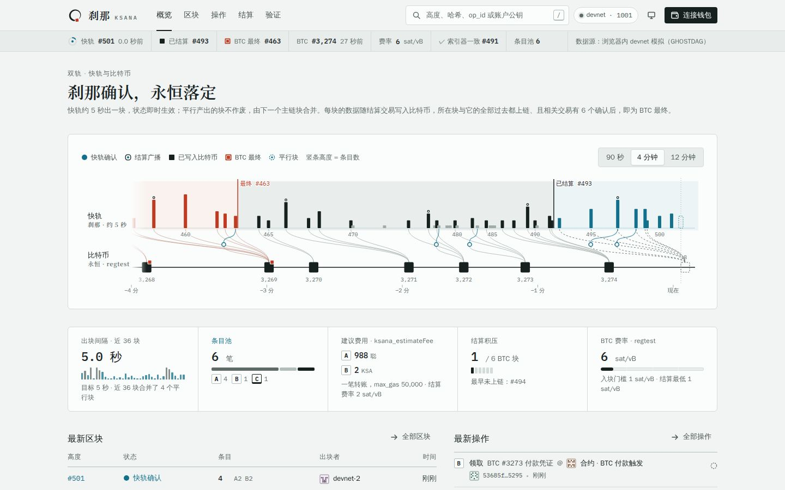
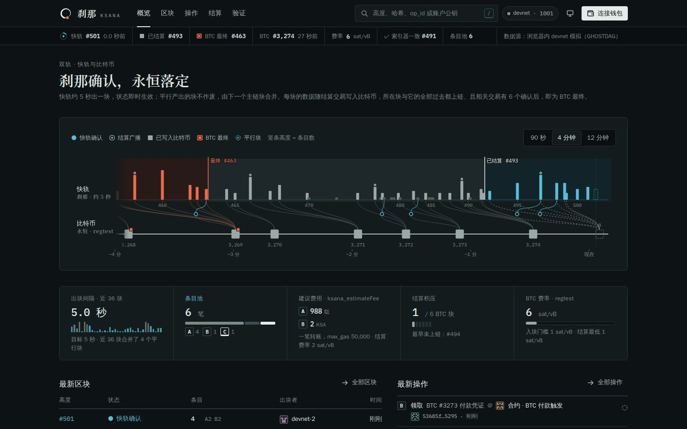
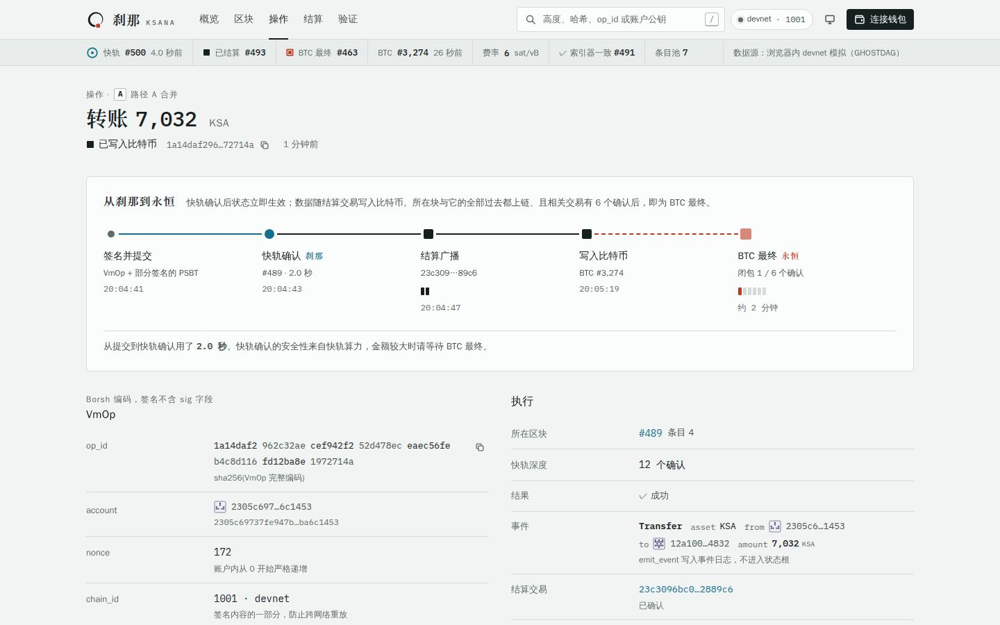
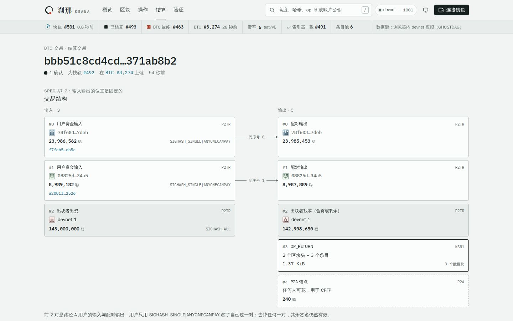
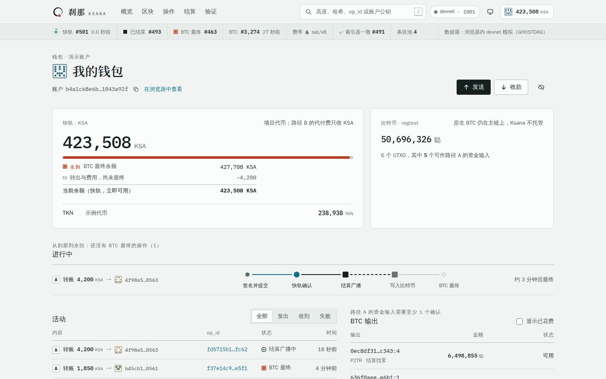
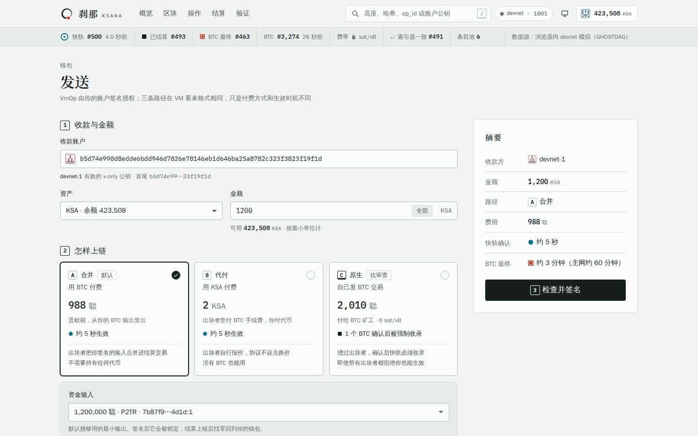
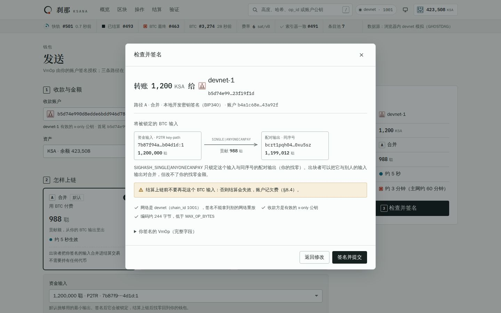
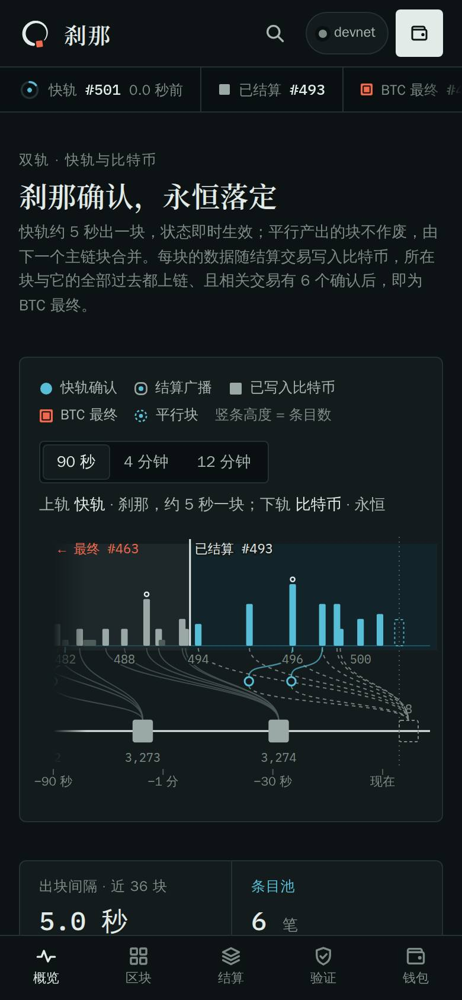
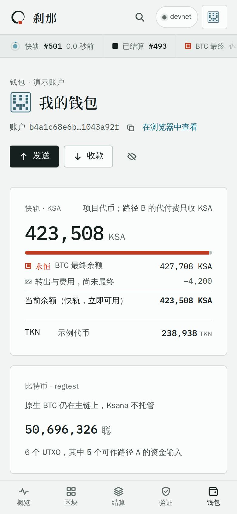
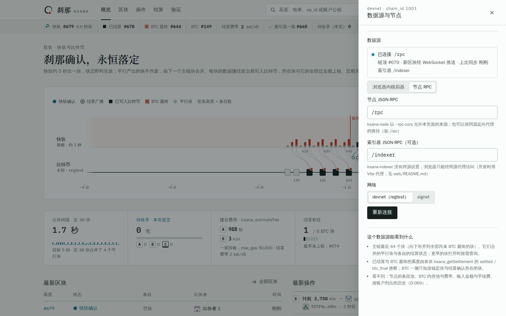

# Ksana web wallet and block explorer: design notes

> The fast lane confirms within an instant, and the result is finally written into the eternity of Bitcoin. (SPEC §1)
>
> This interface does one thing only: let the user see at any time whether an operation is now in the "instant" or in "eternity".

The code is this repository, with the Ksana repository it builds on at `core/`; see `README.md` for how to run it. The interface has two data sources (D-064): the in-browser devnet simulator (`src/chain/sim/engine.ts`),
whose rules follow the implementation on the Ksana repository's `main` (GHOSTDAG block DAG, the commit / reveal pair of settlement transactions with carried bodies, the settled closure and BTC-anchored finality, two-speed difficulty, cumulative unlock and
block share, top-ups through the example exchange contract, D-033–D-092), for the online preview and interface testing; and a node's JSON-RPC (through `@ksana/sdk`), for connecting to a real devnet / signet
(section 7). An account is a Taproot address (D-092): the whole site uses a single identifier.



---

## 1. Design philosophy: the instant and eternity

### 1.1 The one thing a user really needs to understand

Every operation on Ksana has two kinds of certainty (SPEC §10.4, D-038, D-063):

| | Fast-confirmed | BTC final |
| --- | --- | --- |
| Condition | Executed by a main-chain block (or included in a merged parallel block and executed in the main-chain block that merges it) | The main-chain block that accepts the block it is in has entered the settled closure, and the transactions that landed them on BTC all have 6 BTC confirmations, which decides it, and the BTC block of that decision has 6 too: 11 for the transactions (D-114) |
| Time | About 5 seconds | About 110 minutes on mainnet (about 5.5 minutes in the devnet simulator) |
| Secured by | The fast lane's own PoW hashrate | Bitcoin |

The spec requires nodes and the SDK to "distinguish the two states clearly to applications, and let the application decide by amount which one to wait for". Explorers and wallets of existing chains usually have a single "confirmed"; on Ksana
that would be misleading: a fast-confirmed state has already taken effect and can be used further, but until BTC final its security comes only from fast-lane hashrate (SPEC §16).

So the first principle of the interface is: **the two confirmations are always stated separately, and always visible together.**

On the way from one to the other the page counts the data's Bitcoin confirmations to 6, the number Bitcoin wallets count to (about 60 minutes on mainnet), and shows the sixth as a milestone
of its own. BTC final follows it as a seal that counts nothing of its own: the page never counts to 11 or shows the two numbers added up, and the time it gives for BTC final is the same (D-116).

### 1.2 Metaphor: brush, ink, seal

The project name comes from the Sanskrit kṣaṇa, the smallest unit of time in Buddhist scripture. Calligraphy and painting give us a ready-made set of actions that happen to match the life of an operation:

| Calligraphy | Operation | Interface |
| --- | --- | --- |
| Brush down | Signed and submitted, included on the fast lane, state takes effect at once | Cyan, circle: the instant |
| Ink lands | Block data written into Bitcoin with the settlement transaction | Ink, square |
| Ink dry | The data has 6 BTC confirmations, as many as a Bitcoin wallet counts | Ink square with a check: the milestone shown first (D-116) |
| Seal impressed | Settled, the related transactions have 6 BTC confirmations, which decides it, and the BTC block of that decision has 6 too (D-114) | Vermilion seal with a meander-pattern border: eternity |

A piece of calligraphy is not finished when the writing is done; it is final only once the seal is impressed. An operation takes effect once fast-confirmed, and is final only once written into Bitcoin and sealed.
The ink dries first, and the seal comes down on dry ink: the page counts the six confirmations as a Bitcoin wallet does, and the seal follows without a count of its own.

GHOSTDAG adds a stroke to the metaphor: when two producers find blocks at the same height almost at the same time, the other block is no longer voided but joins the main stroke like a tributary, merged by the next main-chain block
(D-063). The interface draws it as a thin line below the fast lane, flowing into the block that merges it.

A small coincidence, too: the "Abhidharmakośa" says "one hundred and twenty ksanas make one tat-ksana"; the fast lane produces a block every 5 seconds and Bitcoin mainnet one every 10 minutes, so the ratio of block intervals is also exactly 120 to 1.

### 1.3 Design principles

1. **Two kinds of certainty, always stated separately.** Every state says whether it is "instant" or "eternity"; balances give both numbers, "current" and "BTC final" (section 5.2).
2. **Verifiable, no trust required.** Show the state_root checks, the settlement transactions and the BTC blocks, so the user can follow the links down to the raw data on Bitcoin. "Verify" is top-level navigation.
3. **Ask what to do, not which protocol.** Sending defaults to path B (sponsored fee in KSA, the wallet signs with BIP322); the interface does not make the user choose a path or a signing method; without KSA, the user first goes to
   the Top up page to buy KSA with BTC (D-078, D-085). Path C is proposed only when rejected or after waiting too long.
4. **The censorship-resistant exit is always visible.** When a path B operation has waited too long, the wallet proactively suggests switching to path C (carrying the same operation in a BTC transaction), pre-filling the same nonce, amount and max_gas
   (SPEC §2.8, §5.3).
5. **Speak the protocol's language, and plain language too.** Terms match SPEC and `core/docs/RPC.md` (VmOp, op_id, state_root, settled closure, entry pool, ...), and every term comes with one sentence on what it means for the user.
6. **Bold in one place, quiet everywhere else.** The two-lane view is the only large visual; the other pages are quiet tables and plates. The most common state in lists, the one that needs the least attention (BTC final), is also the quietest.

---

## 2. Visual language

### 2.1 Color: three ink colors speak only of certainty

Color carries one meaning only: certainty. Everything else is shades of indigo gray on a moon-white ground.

| Token | Light | Dark | Meaning | Used for |
| --- | --- | --- | --- | --- |
| `--qing` cyan | `#12708c` | `#58bed7` | The instant: fast-confirmed | Fast-lane bars, the block clock, the fast-confirmed mark, parallel blocks |
| `--mo` ink | `#16201f` | `#9aa9a5` | Ink lands: written to Bitcoin | The BTC lane, BTC blocks carrying Ksana data, blocks written to Bitcoin, their six confirmations |
| `--zhu` vermilion | `#c03a22` | `#ee6a4d` | Seal impressed: BTC final | The vermilion seal, the final boundary, BTC blocks whose Ksana data is BTC final |
| `--warn` gamboge | `#93600a` | `#e1a640` | Needs attention | Backlog near the limit, skipped, stuck in the mempool, censorship, large amount not yet final |
| `--danger` magenta | `#a3277a` | `#e27bc8` | Error | Execution failed, backlog at the limit, input errors |
| `--bg` ground | Moon white `#f1f4f3` | Raven blue `#0d1314` | Background | The page |

- The background is a cool white with a teal cast, not the usual warm beige; the dark one is raven blue, not pure black. Dark mode is not an inversion: text turns paper-colored; "ink" recedes to a mid gray so that blocks written to Bitcoin are not brighter than the vermilion seal, and the three colors still progress cyan → ink → vermilion.
- The warning colors deliberately avoid vermilion: here vermilion means "final", not "error". Failure uses magenta, about 50° of hue away from vermilion, so color-blind users can also tell failed from final.
- Cyan means fast-confirmed only. The network chip, indexer checks, information banners and the pre-signing checklist all use neutral ink gray and do not borrow cyan.
- Bitcoin orange is not used. In the interface Bitcoin is "ink": what gets written in.
- Every text color has a contrast ratio of at least 4.5:1 (WCAG AA) in both themes on all three backgrounds (page, panel, status strip), and the muted text on the fourth too, the background of a hovered row and of the search's chosen suggestion (the dark muted ink was lifted a shade for it). The tokens are defined in `src/styles/tokens.css`.
- A field's edge (`--line-field`: `#7e8a86` light, `#586e70` dark) stands at least 3:1 in both themes from the page, a panel and the inset ground of path C's details
  (WCAG 1.4.11), as the edge is what shows where a field takes what is typed. The text fields and the menus had drawn theirs in the strong line between parts, 1.7:1 on
  the page in the light theme and 2.2:1 in the dark one, and the search boxes and the language menu in the light line, 1.3:1 and 1.4:1; the lines between parts stay
  light. A focused field's edge turns the accent, which this edge brings near in lightness (1.6:1 apart in the light theme, from 2.95:1), so the field is also ringed
  outside its edge by 1 px of the accent, 4.7:1 at least from what it sits on, under the accent's soft halo; a field marked invalid is ringed in the color of the error,
  as its edge is.
- A placeholder is drawn in the muted ink (`--ink-3`), 4.5:1 at least on a field in both themes, as the search box's always was: the text fields had the browser's own
  gray, `#757575` in Chromium whatever the theme, 4.48:1 on a field in the light theme and 3.8:1 in the dark one.
- With Increase Contrast on (iOS, macOS: `prefers-contrast: more`) the muted inks and the lines go a step nearer the ink in both themes, whether the theme follows the
  system or was chosen. On each of the four grounds the second ink then stands 9:1 at least and the muted one 7:1, a field's edge 4.5:1, the faintest ink 3.5:1, the
  strong line 3.2:1 and the lines between parts 2:1; without it they read at their lowest 6.6:1, 4.55:1, 2.9:1, 1.9:1, 1.6:1 and 1.15:1 in the light theme, and 7.5:1,
  4.6:1, 2.9:1, 2.2:1, 1.8:1 and 1.17:1 in the dark one. The faintest ink (`--ink-4`) draws the steps still to come and a skipped step's dash, the rail's threads, axis,
  line for now, Bitcoin blocks and empty blocks, the dots between the parts of a line, the Verify page's arrows and the mark of an empty list. The empty part of a mark
  (`--mark-empty`: a tick not yet reached, the ground of the gas, split and pending-operations bars) is drawn as the light line and rises less, to 1.46:1 at the lowest in
  the light theme and 1.68:1 in the dark one, so that what fills a tick or the gas and split bars stays 3:1 from it, where the lines' step would have left it as near as
  2.2:1. The three colors of certainty stay as they are.

### 2.2 Shape: from circle to square

Besides color there is shape, so color-blind users can tell states apart too. A circle stands for the flowing moment, a square for having settled:

| Mark | State | RPC status |
| --- | --- | --- |
| Gray dashed circle | Pending (in the entry pool) | `pending` |
| Cyan dashed circle with a dot in the middle | Parallel block awaiting merge | The block's `accepted_height` is empty |
| Solid cyan circle | Fast-confirmed | `fast_confirmed` |
| Rounded square outline with a cyan dot in the middle | Settlement broadcast | `fast_confirmed` (the main-chain block that accepts the block already has SETTLEMENT_DEPTH blocks after it, and the settlement has been broadcast) |
| Solid ink square | Written to Bitcoin | `fast_confirmed` (in the settled closure) |
| Solid ink square with a check | Six Bitcoin confirmations: the settled closure's data has BTC_FINALITY_CONFS of them (D-116) | `fast_confirmed` |
| Vermilion seal with a meander-pattern border | BTC final | `btc_final` |
| Gamboge circle with a dash | Skipped: appears only in merged parallel blocks; not executed at merge, and not charged | `skipped` |
| Magenta circle with a cross | Execution failed | `failed` |
| Gray circle with a slash | Dropped from the entry pool, will not be included | The node returns `-32004` (D-068) |

The three intermediate states (settlement broadcast, written to Bitcoin, six Bitcoin confirmations) are not return values of `ksana_getOpStatus`; they are derived from the states of the block and the settlement transactions. They tell the user "the data is already on
Bitcoin, only the confirmations are missing", which is useful for judging risk. Six confirmations are counted by the page, not reported by the node: a node decides the block final then if its
fast-lane chain is the heaviest on Bitcoin, which the page cannot see, so the hover text of that mark still tells large amounts to wait for BTC final. See `src/components/Status.tsx` for the implementation.

The same set of shapes is used everywhere: in the two-lane view a BTC block carrying Ksana data is a solid ink square, with a vermilion seal stamped on its corner once that data is BTC final, at its 11th confirmation at the earliest, and only one still in the mempool is drawn as a dashed outline;
in the progress bar the step in progress is a translucent solid shape with a breathing glow, and a step not yet started is a small gray ring with no shape semantics -- a hollow square means "settlement broadcast" only.
The path C mark is an outline with an ink line along its bottom edge (Bitcoin first); it is not a solid square, to avoid confusion with "written to Bitcoin".

### 2.3 Typography

| Role | Typeface | Usage |
| --- | --- | --- |
| Headings | Song (serif): a Noto Serif SC SemiBold subset (bundled with the app) → the system Song face; other languages below | Page titles and the wordmark (the name "Ksana" uses this subset in every language); used sparingly |
| Body | System sans-serif: PingFang, Microsoft YaHei, Noto Sans CJK; other languages below | 14px base, line height 1.6 |
| Data | IBM Plex Mono (bundled with the app) | Heights, hashes, amounts; tabular figures, slashed zero |

- The Song typeface descends from the woodblock-printed books of the Song dynasty and is the classic face of Chinese printing, from the same cultural lineage as the ensō and the seal. Most phones and Linux systems have no Song face, and the full Noto Serif SC
  is too large (about 15 MB per weight); the interface copy is fixed, so only the roughly 800 characters the copy uses are bundled (`scripts/subset-font.py`, SIL OFL 1.1),
  in two files: the Latin letters and general punctuation (about 16 KiB) and the Han characters with the CJK punctuation (about 105 KiB). Each `@font-face` takes its file's code
  points, so the browser downloads the Han file only for a heading with Han text in it: a page in any language but Simplified Chinese, and the wordmark in every language, take
  the Latin file alone.
  Characters in dynamic content that the subset does not cover fall back character by character to the system Song face. Headings set `font-synthesis: none` to avoid faux bold.
- Other languages (D-071): English and Spanish headings use the Latin letters in the same subset (the subset contains all of Latin-1), but not its curly quotation marks and ellipsis,
  which Noto Serif SC sets full width for Chinese text ("Can’t" would open a gap): another `@font-face` over the Latin file leaves them out by `unicode-range`, and the next serif in the
  stack supplies them. Han characters have different glyph forms in Chinese, Japanese and Korean, so Traditional Chinese, Japanese and Korean do not borrow the Simplified Chinese subset;
  headings and body each use the system fonts of their own language (Ming, Mincho, Myeongjo and the matching sans-serifs), switched by `<html lang>`.
- The wallet makes no requests to third parties: both fonts are bundled with the app, in the online preview as well.
- In amounts the integer part is emphasized, the fractional part is de-emphasized, and the unit is lightest of all; every numeric column aligns with tabular figures. KSA is shown and entered with 8 decimal places (SPEC §8.6, D-066), other assets with
  the precision from `ksana_getAsset`; next to an amount the integer in base units is visible, matching `--amount` of `ksana-cli`. An asset's amounts wait for its precision: until
  the node answers for the asset, they show as being read ("…" beside the asset's ID, as a balance being read does), never in base units its precision would turn into another number
  ("1,000,000,000,000 Asset 0841ac" for "10,000 Wizards"). An asset the node says it does not have (`-32004`) keeps its ID for a name and shows its amounts in base units, which is
  all there is; one it did not answer for (the node unreachable, a timeout) stays being read, and is asked again with the first sync 8 seconds on. A toast about such an amount
  waits for the name, as its words stay, and the send form offers the asset once it is named. What a read comes upon (a sync, a block, an operation or an account opened from a link,
  a page of a listing) shows once the names and decimals of its assets are in: the assets a transfer moves and those of the funds a call or a deployment attaches (D-073) are asked
  for as its operations come in, and the assets an account holds as its balances come in, with the first load's settlements.
  Each read waits for the assets asked for since it began, not for those another asked for before it, and for two seconds at most: the amounts of a slower answer show as being
  read until it comes, and a sync that met no new asset holds up no new block for a block page's.
- In Chinese, Japanese and Korean a figure often carries a word in their script (a count's measure word, a duration's units), and a monospace space beside a CJK character reads as two:
  there a figure's spaces are narrowed to about a proportional one (`word-spacing`, by `<html lang>`), except in a unit set in the body face within it, whose proportional spaces the
  narrowing would take away entirely.
- Korean breaks lines at the spaces between its words (`word-break: keep-all`), as Korean is set, where by default a line could end between any two syllables of a word.
  A Japanese page title breaks after its punctuation the same way, as a Japanese heading is set (the overview's broke "Bitcoin" in two on a phone); a run too long for
  its line still breaks. So do the labels of the send summary's narrow column and the notes of the fee and the fee rates in every language, a count keeping its
  measure word ("6 confirmations" in Chinese and Japanese, joined by a no-break space, as Spanish joins "6 confirmaciones" in the names of a stage and a step).
  Japanese keeps a small kana and the long vowel mark off the start of a line (`line-break: strict`), as its typesetting does.
- A figure and its unit do not break apart: "2 sat/vB" and "max_gas 50,000" are joined by a no-break space, as is an amount in a message and its asset or unit ("0 KSA",
  "546 sats", a token's symbol). Nor does a figure in the page's words and the word after it, most often the one it counts or measures ("64 hex characters", "the 12
  blocks after it", "6 confirmaciones", a count and its measure word in Chinese, Japanese and Korean): as each language's messages load (`typeset`), the space between a
  figure and a letter after it becomes a no-break space, unless the figure ends a word or a name or is part of one ("BIP340", "SHA-256", "#2,299", "12:30"), in a
  message's text and in the fragments and HTML elements it makes, a figure given as a parameter among them, so that no translation has to mark it; an element the page
  gives a message (a link, an amount) and the text of code or of an option are left as they are. Two figures with a mark between them, a fraction, a comparison or a
  range ("12 / 12 blocks", "2 < 5 sat/vB", "#2,297 – #2,299"), are joined the same way, and a range, a fraction or a sum in words by hand ("from 1 to 500", "2 of 6",
  "k + 1"). On a phone the search page's tips had ended a line with "64" before "hex characters", and the Verify page with the "2" of "the 2 after it", in Spanish
  and Japanese as well.
  Where a value sets a note beside a link (a BTC block and its confirmations, a block and its entry, a fee and its rate), the note goes below the link whole when the
  two do not fit side by side: squeezed beside the link, a figure and its word broke inside the word, "72 confirmation" over "s" in a tablet's column.
  A relative time is one phrase and never breaks ("9 min ago", "hace un momento"): in a table's time column it read "9 min" over "ago".
  Words that change as the clock ticks, a relative time and a wait counted down ("~45 s"), set their figures to one width (`.ticking`), so that neither they nor what
  follows them on their line moves from one second to the next: Apple's system font, the body face on an iPhone or a Mac, gives each figure its own width.
  A figure keeps to one line; only where a line may be too short for it (a phone's card rows, the wallet's tokens) does it
  break, after a comma, never inside a group of digits, set to the right with its unit after the last group. The overview's stat labels wrap where a language needs a second line, on every screen, rather than end in an ellipsis: a label
  or note of phrases joined by " · " breaks after a dot before it breaks inside a phrase, and the stats of a row keep their figures, graphics and notes level (a
  subgrid), so a label of two lines moves no figure. A stat's unit sits close to its figure, in the body face, as an amount's does ("7 ops", "2 sat/vB"), and so
  do the words of a duration ("3 min 46 s", with a figure's space between its two parts). A readout that runs figures and words together (a payload's
  "4 block bodies", a block's "gas 206,858 / declared limits 520,000", a contract's "26,880 bytes", an operation's "1 confirmation") sets its figures in the
  monospace face and its words and units in the body face, as a stat does; set wholly in the monospace face, its words read as code.
- A placeholder is a hint in words: it is set in the body face even in an input whose value is monospace, and it is short enough to show whole in a phone's field,
  naming the forms the field takes ("Taproot address or hex account") and leaving their details to the hint below and the errors; where a narrower phone cuts it (320 px),
  or a narrow desktop window the top bar's search box, it ends in an ellipsis while the field is not being typed in, as a value longer than its field does. All text, not only a page's prose:
  a paragraph, a table cell, a hint below a value, a group's title, avoids ending on a lone short word, or in Chinese or Japanese on a lone character, where the
  browser can (`text-wrap: pretty`, which the page sets once for everything to inherit); a heading, a button's label and a phrase of a stat's label or note balance
  their lines instead. Bytes given as hex (a call's arguments on a node, an event's data) give their length on a line of its own below them: after the hex on its line,
  that wrapping took a hex digit down to the length on a phone, and "0 · 64 bytes" read as a value of its own.
- A label and the name it gives stay on one line (`.nobr`): the two-lane view's caption on a phone keeps "Top: Ksana" and "bottom: Bitcoin" whole, the review dialog
  keeps "Account" with the address it names, and the receive page keeps the two ends of the address together. The data source panel's status line ("Tip #436 ·
  Polling every 2.5 s · Last sync just now") breaks between its parts, not inside one, and so does the Verify page's line of the BTC tip and the indexer's height
  (on a phone "Indexer is" ended a line above "at BTC #…", and a Japanese word was split). The addresses in the panel, the node's above it and the indexer's and Bitcoin
  RPC's below, go whole onto a line of their own where the words beside them leave too little room, as on a phone, and a web address longer than its line breaks as
  an address does, after its "//" and before a "." or a "/" (and after a hyphen, as any text may), where a hash breaks anywhere: "https://signet.ksana.networ" over
  "k/rpc" read as two words.
- A full hash, set in groups of eight so that it can be checked piece by piece, and an address grouped in fours (the Receive page's, the send review's) copy as one
  string, as a wallet or a search box takes them: the groups stand apart by a space drawn before each, which a selection does not take, as wide as the gap they had,
  rather than as boxes of their own, each of which a selection copied as a line (`.full-hash-groups`, `.addr-groups`). A double click takes the whole value.
- A section's tabs, button or checkbox beside its title sit on the title's baseline (its last line's, where the title wraps) rather than at the bottom of its box,
  which set their labels a few pixels above the title's.

### 2.4 Logo: the ensō and the vermilion seal


The ensō is the circle of Zen painting drawn in a single stroke, painted in an instant, symbolizing completeness and eternity. The logo is an ensō whose stroke begins full and runs dry toward its end, with a vermilion seal stamped at the lower right, like the seal beside the signature of a painting.
The stroke is generated by code (`src/components/Brand.tsx`). A phone's home screen and Safari's tiles take a picture instead of the SVG: the page publishes
the project site's icon (`public/apple-touch-icon.png`, a copy of ksana-site's `src/img/apple-touch-icon.png`), and a page kept there is named Ksana rather than by
the page that was open.

The same circle is also the **block clock** in the status strip: each fast-lane block fills one full turn over the expected gap (5 seconds; with a node, the next
block's weight in target times, at most the median gap of its last 20 blocks, as the estimates count it, section 4.3), and the center flashes cyan when a block is produced. When the turn is full and no block has come, the ring turns into a rotating
dashed line, showing that PoW block production is sometimes fast and sometimes slow. The arc advances a device pixel at a time, and the dashed ring turns as a
whole, an animation the browser runs without the page's scripts: a clock redrawn every frame kept every page busy while nothing moved.

### 2.5 Ticks

Confirmation counts, broadcast depth and backlog level are all drawn as discrete tick cells, and the number of cells is the protocol parameter: 2 cells for settlement broadcast (SETTLEMENT_DEPTH), 6 for the Bitcoin
confirmations (BTC_FINALITY_CONFS), 6 for the settlement backlog (SETTLEMENT_TIMEOUT). The user need not remember the parameters; counting the cells tells how much is left. The confirmation cells count from the
BTC height at which the main-chain block that accepts the block entered the settled closure, not from this block's own settlement -- the transaction in the closure that landed last decides when it becomes final.
BTC final has no cells (D-116): once the six are filled, its step is in progress with the note "Securing" and the time it is expected, BTC_FINALITY_CONFS − 1 BTC blocks later at the earliest, when the BTC
block of the determination has its own six (D-114). With those blocks all there and the block not BTC final yet (with a node: not reported yet, as when the determination waited), its note says it waits for
the node's report. Done, it says what taking it back would take: a Bitcoin reorg of BTC_FINALITY_CONFS blocks or more. The BTC block page counts its confirmations to six the same way, its cells turning vermilion
once its data is BTC final.

### 2.6 Motion

| Moment | Motion | Meaning |
| --- | --- | --- |
| New fast-lane block | The block clock's center flashes; new list rows fade from cyan | The instant |
| Two-lane view | Content keeps moving left with time | Time passes, Bitcoin catches up |
| Six Bitcoin confirmations | The checked ink square comes down like the seal | Ink dry |
| BTC final | The seal comes down: scales up, turns slightly, settles | Seal impressed |
| Step in progress | The marker breathes gently | Happening now |

A mark comes down as its step is done while the page shows it: the marks of the steps done before the page was drawn are drawn still, so that the page of an operation
final hours ago does not open on its seal coming down, as if it had just become final.

When the system has "Reduce motion" on, all animation is disabled and the two-lane view refreshes once per second instead.

Motion is drawn only as fast as it shows: the two-lane view is laid out again every second and pans between two layouts a device pixel at a time (a window of hours
does not move one in a second), and the block clock as above. A list is drawn again when what it shows changes, its relative times keeping their own clock, and a new
row fades from cyan for the whole 900 ms however often its list is drawn again meanwhile, as the next row arrives or a status changes. The marker of a step in
progress breathes with a copy of itself, which grows by 5 px a side as it fades out and comes back, scaled and faded by the compositor (`node-breathe`) so that no page
is restyled for it; with "Reduce motion" on the marker keeps a still ring instead.

What arrives does not move what is being read. Where content grows or shrinks above the first thing in view (a block or an operation arriving at the head of a list
read halfway down, a section that loads above), a browser keeps that thing where it stood (scroll anchoring, `overflow-anchor`). WebKit has done so only since Safari 27
(September 2026): on an iPhone or a Mac on iOS or macOS 26 or older a live list moved down a row at a time, on the operations page of a busy chain several times a
second. Where the browser has no anchoring of its own the page does it (`src/app/anchor.ts`): it holds the first element in view under the top bar where it stood,
to under a pixel however many rows arrive (WebKit scrolls to whole pixels, so what one move leaves over goes into the next), and at the very top of a page it holds
nothing, so that what arrives there is seen arriving. While the reader scrolls (a finger on the screen, a fling or a wheel's turn going on, and for 150 ms after) it
moves nothing itself, as a script's scroll stops a fling on an iPhone: what arrives meanwhile moves the rows in view, as with no anchoring, and the place is held again
from where the reader stops. This is measured in Chromium with its own anchoring off, not in WebKit.

The keyboard's focus, while it shows in the window between the bars, is the reader's place, kept where it stands rather than the first thing in view. Above the focus that
was often a row of a live list that keeps its length (on a phone scrolled to the overview's latest operations, a row of the latest blocks), which each block arriving at
the head of the list moved down a row, and the page with it, the focus up: held 40 s in Chromium on the simulator's overview on a phone, the link to all operations went
up by 152 px, and so did an operation's link once its own list held its rows (§6). Meanwhile the page asks the browser to anchor to the focus (`data-place` on the root):
every element the focus is not in, its pseudo-elements with it, is left out of the browser's choice, and so are the pseudo-elements of those it is in
(`overflow-anchor: none`, `src/styles/components.css`), so that it anchors to the focus, or to the outermost element around the focus that the window shows whole.
Left out on the root alone, every element is but those absolutely placed with nothing placed around them, and Chromium anchored to a screen reader's label (`.sr-only`) in
a row of the latest operations below the focus, which moved the page down by each operation arriving above the label; every pseudo-element left out by name made each
restyle of the operations page about a tenth slower meanwhile. The attribute coming or going restyles the whole page once: in Chromium about 7 ms on the overview on a
phone, 11 ms on a desktop's and 24 ms on the operations page (about 40, 55 and 135 ms with the processor slowed four times), as the keyboard moves the focus between the
bars and the page, a press follows the keyboard, or the focus scrolls in or out of the window. A window that loses the focus, to another window or another tab, keeps the
reader's place where it was (`focused` in `src/app/anchor.ts` remembers the focus the keyboard gave): Chromium then matches no focus, `:focus-within` either, leaves
every element out and anchors to nothing, and a list above the focus that keeps its length does not move it. Where the browser has no anchoring of its own the page holds
the focus where it stood: measured in Chromium with its own anchoring off, the link to all operations, which the page's hold of the first thing in view had moved up by
229 px in those 40 s, stays where it stands. A focus a press gave, or one on what is fixed to the window or sticks to an edge of it (the bars, a sheet, the send page's
summary and its bar at the foot, stuck or not), changes nothing: the first thing in view is held.

### 2.7 Account seal

An account is a Taproot address (D-092): the 32-byte output key in the address. From it every account generates a "seal" with a symmetric 5×5 pattern, using only low-saturation hues so as not to clash with the semantics of the
three colors. The seal appears next to every account, including in the recipient field of the Send page. The address has a checksum; the seal is for quick checking, and also guards against "address poisoning" with matching first and last characters (D-065).
All occurrences of the same account on a page highlight together on hover. Beside a label an account's words stand on the label's baseline, the seal centred
on them, as does any other mark set before its words (a stage's mark in the send summary, a merged block's on a block's page).

---

## 3. Information architecture

### 3.1 Navigation

```
Overview · Blocks · Operations · Verify · Contracts        [Search /]  [devnet]  [Theme]  [Wallet]
Two-lane status strip: block clock Ksana #h · Settled #h · BTC final #h · BTC #h · Fee rate (with the fee floor during a spike) · Indexer · Mempool · Data source
Wallet mode (wallet pages): the strip keeps only Ksana #h · BTC final #h · Data source (alerts as usual); mobile bottom bar Wallet · Send · Receive · Top up · Explorer
```

- The **two-lane status strip** sits permanently under the top bar: two clocks (fast lane, Bitcoin), each with its age read alike (whole seconds, then whole minutes), and two boundaries (settled closure, BTC final). A gamboge hint appears when the backlog runs later than settlements in step with Bitcoin take it, from 2 + ANCHOR_DEPTH BTC blocks (3 on signet, 2 on devnet and in the simulator; D-056, D-077), and a magenta alert appears at the very front
  when it reaches the limit; during a BTC fee spike the fee floor is shown. Below 1100 px the right end names the data source (simulator or node); from 1100 px the network
  chip names it ("signet · node", "devnet · simulator") and opens the same panel, and the strip leaves it out: there its readings take all its width in some languages, and the
  source was cut at its edge. From 1 240 px, the strip's full width, a node's readings fit in every language with five-digit heights and two-digit ages (Spanish's, the
  longest, 1 179 of 1 192 px, with 12 px either side of an item's rule); below, they scroll.
- Under the status strip, on every page, in wallet mode too, and on every network, one line in neutral ink says that the test network may start over from a new genesis
  block at any time, and that balances and contracts do not carry over: every network the page shows is a test network, and the signet restarts from genesis without
  notice as much as a devnet (the project owner's decision of 2026-10-30). It wraps where it does not fit rather than scroll like the strip (`TestnetNotice` in `src/app/Shell.tsx`).
- Settlements, BTC transactions and BTC blocks live under "Blocks": the Blocks and Settlements pages have a "Blocks · Settlements" section switch at the top, and Settlements is no longer top-level navigation.
- On phones the navigation moves to a bottom tab bar (Overview, Blocks, Operations, Verify, Wallet); the status strip is ordered by importance, scrolls horizontally, and fades at the right edge to hint that there is more.
  The bar's five tabs are equal, and each label keeps to one line, as a phone's own tab bar does: a label longer than its tab (Japanese "Operations" and "Explorer", 7
  katakana each) is set smaller until it fits, down to 70%, and cut short only below that, fitted again whenever the bar's width or the label's own size changes; Japanese
  kana there are set proportionally (`palt`), and the wallet's "Explorer" tab takes the shorter of that word's two spellings in common use (the longer one, 8 katakana,
  stays in sentences and links).
- Back and Forward return to where each page was left (a list read halfway down, a block opened from it, then Back), and so do a reload and a return from another site
  in the same tab; a page reached by a link starts at its top. The page keeps each history entry's place itself and goes there once the page is drawn tall enough,
  waiting a few seconds for one that loads its data first; a reader who scrolls, taps or types meanwhile stays where they are. The browser's own restoration is off:
  WebKit applies it before the page learns that the address changed, and no browser waits for data that arrives after the page has opened. WebKit keeps that setting
  for each history entry and gives an entry made by a change of hash its own restoration back, so the page makes its entries with `pushState`, which carries the
  setting over, and turns it off again on any entry it arrives at (one the address bar or a script made). A move between two entries of the same address (the
  blocks list opened twice, then the history menu) is told by `popstate`, which every move announces, where a change of hash is not. The places are kept for a
  reload whenever the page is hidden too, as a phone may discard a tab in the background without the page being told it is leaving. A page going back to its
  place gives focus back to the link it was left from, where a keyboard had it, rather than to its title: the title is above the screen there, and the first Tab
  after it would take the reader back to the top. It is that very link where the page has several to one address (a send's result names its operation in its
  head and again at its foot), and focus goes there once the page stands at its place or near it, as a page grown shorter since (an operation confirmed
  meanwhile) stops short of it.
- **Wallet mode**: the wallet pages (Wallet, Send, Receive, Top up, Settings) are a different posture -- the user is looking at their own money, not at the chain. The status strip keeps only the fast-lane clock, BTC final and the data source
  (disconnection and backlog alerts still appear), and the bottom bar becomes Wallet · Send · Receive · Top up · Explorer; returning to the explorer pages restores the full two-lane status strip.
- Clicking `devnet` in the top bar opens the **regtest console**: mine BTC blocks by hand and stage scenarios such as a fee spike, producer censorship and a producer going offline (section 5.6).

### 3.2 Pages

| Route | Page | Main content |
| --- | --- | --- |
| `#/` | Overview | Two-lane view, network stats, latest blocks and operations |
| `#/blocks` | Blocks | Main chain / parallel blocks, hide empty blocks, go to height |
| `#/block/:height-or-hash` | Block detail | The life of the block, header v2 (parents), DAG (accepted height, merge set), entries grouped by inclusion rule (including skipped entries), settlement |
| `#/ops` | Operations | Latest / mempool (with a note on "why it is not included yet") |
| `#/op/:op_id` | Operation detail | Progress from the instant to eternity, the VmOp plate, the execution result (with a node, the changes to built-in assets its receipt records and a token's events read by its standard, D-122, D-123), why it was skipped or dropped |
| `#/account/:address-or-hex` | Account | Address, balances (with a node, its KS-20 tokens among them and the KS-721 collections it holds NFTs of, D-123), the nonce its next operation must use, a producer's locked block rewards and fees and their unlocks |
| `#/contract/:id` | Contract | Metadata, read-only calls (ksana_call; the simulator answers its demo contracts' from its state, amounts with their decimals, a structure field by field, and says when it does not model a method), recent calls; with a node, what the page knows of it, the standard it declared with a link to its asset's page (D-123), and the calls and transfers to it (section 7.2) |
| `#/asset/:id` | Asset | A built-in asset's rules, the connected account's standing and its history; a KS-20 token's or a KS-721 collection's figures from the node's index, its largest holders and its history (section 5.2, D-123) |
| `#/settlements` | Settlements | Settlement / native / republish transactions, fee bumps and conflicts |
| `#/tx/:txid` | BTC transaction | The transaction structure diagram of §7.2 (commit / reveal), the headers and bodies in the payload, fees, republishing and replacement; `?block=` names the block it is read from (section 4.4) |
| `#/btc/:height` | BTC block | The Ksana transactions in it (each settlement's commit before its reveal), without their confirmations, the block's own, which its head gives; every block header and body their payloads carry (D-077), the fast-lane blocks anchored to it |
| `#/verify` | Verify | Indexer checks, the two confirmations, protocol parameters |
| `#/wallet` | Wallet | Connect, balance under both confirmations (a top-up entry point when KSA is 0; in node mode a line with the indexer status), the other assets and the NFTs, those the account never asked for folded away (D-123), in progress, activity, BTC outputs / wallet info |
| `#/wallet/send` | Send | Recipient and amount → choose the path → review and sign → live progress |
| `#/wallet/receive` | Receive | Account address (also the BTC address), QR code, incoming confirmation rules (large-amount threshold edited in place), recently received |
| `#/wallet/topup` | Top up | Buy KSA with BTC: read the seller's lock, the price, pay and claim (D-085); `?exchange=<contract>&lock=<id>` fills both in and reads the lock (the points page's seller, D-126) |
| `#/wallet/settings` | Settings | Theme, language, large-amount threshold and hide balances, data source, wallet connection, About (build fingerprint, chain, source, how to verify) |

### 3.3 Search

One box searches everything: fast-lane heights (`128`, `#128`; parallel blocks at the same height are listed too), BTC heights, 64 hex characters (block hash, op_id, txid, account,
contract, asset), Taproot addresses (which are accounts, D-092), names (`devnet-1`, `AMM`, `faucet`), and the assets the page knows by their symbol or name: built-in assets, KS-20
tokens and KS-721 collections, each shown by its symbol with its ID beside it, since anyone can name one anything; a whole ID the page does not know is offered as an asset's too (D-123). Typing 4 or more hex characters suggests matches by prefix. `/` focuses the box, the arrow keys select,
Enter jumps. A suggestion names its kind in a column of its own, wide enough for the longest word among the kinds: 72 px, and 100 px in Japanese, which names a kind in one word of up to eight kana; a kind breaks between its words only. Other kinds of BTC address are not accounts, and the search tips say so explicitly; when nothing is found, the page explains what can be searched for instead of showing an empty page.
The search page's own box holds the query it shows, as a search engine's does, so that a typo is corrected in place rather than typed again; the top bar's box empties once it has searched.
Its title gives a query of more than 20 characters with no space in it (an address, a hash) by its first 8 and last 6 characters, as a page's title gives a hash
("No results for “tb1qw508…xpjzsx”"), joined to the ellipsis so that a line breaks before the query rather than inside it: in full, a phone's title broke an address over
three lines, and a tablet's left its last two characters on a line of their own. The box below holds the query whole.
The tips speak of the network the page shows: the address prefix is its own (`tb1p…` on signet), and with a node the names offered are the ones the page actually knows.
Where the query itself says why nothing is found, the page says so above the tips (`searchMiss`): a height no block is at yet gives the chain's tip, and Bitcoin's
as well past Bitcoin's tip, where no block of either chain is, "as far as this page knows", as the page's tips may trail the chains' (a height only a parallel block is at
is found, and listed); a Bitcoin address of another network names the networks it is for, the one the page's network runs on and the prefix of its accounts; an address
of the page's network that is not a Taproot one says that an account is a Taproot address and that a wallet is used here from its Taproot account, and a Taproot address
that no key stands behind (its 32 bytes are no point of the curve) that it cannot be an account, as no one can sign for it; both link to the address on mempool.space on
signet ("View this address on mempool.space/signet"), only an address of signet's network and a bech32 one in lower case, as explorers spell it. An account's page opened
for such an address says the same (`accountMiss`), and one opened for anything else that is neither an address nor 64 hex digits says what an account is, in place of
the simulator's word on old links; a block's page for a height above the tip that no parallel block is at says that the block has not been produced yet (`blockAhead`),
rather than that the node does not have it.

---

## 4. Explorer

### 4.1 Overview: the two-lane view



The two-lane view is the only large visual in the whole interface; it draws the system architecture of the SPEC as a live chart:

- **The horizontal axis is time**, with now at the right end. The windows follow the pace of BTC: 90 seconds, 4 minutes and 12 minutes where BTC blocks come seconds apart (the simulator, devnet), 4 minutes,
  30 minutes and 3 hours where they come ten minutes apart (signet), so that the view always reaches the BTC lane. An idle signet fast lane opens on 3 hours: BTC final is about eleven BTC blocks behind
  the fast lane (D-114), and the view reaches past it.
- **The top lane is the fast lane**: one bar per main-chain block, the bar height is the entry count, and an empty block is a small tick. A bar with a small circle contains forced-inclusion entries.
- **Parallel blocks** are drawn on a tributary below the fast lane: a small cyan circle which, once merged, has a thin line flowing into the main-chain block that merges it; one not yet merged is a dashed circle. Hovering tells which block merged it
  and how many duplicate or conflicting entries were skipped.
- **The bottom lane is Bitcoin**: one square per BTC block. Those carrying Ksana data are solid ink squares, with a vermilion seal stamped on the corner once that data is BTC final; those without are light gray squares (on a node, "No known Ksana transactions": the page knows only the transactions of the blocks it loaded); those still in the mempool are dashed outlines. The number over the mempool counts the settlements waiting there, each once by its reveal transaction, not again by its commit (D-081); the settlements page's "In BTC mempool" is the same count.
  The seal, and the stage the hover gives, follow the BTC-final height, so with a node what the node reports (D-114): the seal comes once every block a chain block accepts whose headers or body the square's settlement and
  republish payloads carry, or that a settlement there is for, is final. That is at the 11th confirmation at the earliest, later while the node's determination waits, and for a parallel block's own settlement once the chain
  block that merged it is final; a path C operation the square carries shows its own stage.
  With a node the time of a BTC block is its own where the page read it as the tip, and otherwise estimated (section 7.2); BTC blocks first seen by the same fast-lane block share one estimate: the older squares then step at least 20 px to the left, so none hides behind another.
- **Settlement threads**: they hang from a fast-lane block (or parallel block) down to the BTC block that confirms it, and many threads converge on the same BTC block. A thread broadcast but not yet confirmed is dashed and points to the "BTC mempool" at the right end.
- **Three background bands**: vermilion is BTC final, ink is written to Bitcoin (the settled closure), cyan is fast-confirmed only. With every BTC block the two boundaries jump right once, Bitcoin catching up to stamp its seal.
  When the two boundaries coincide they merge into one label, "Settled · final"; when too close, they are staggered vertically, and so is the settled label beside the hint of a final boundary
  scrolled out of view. A boundary's label runs right of its line, or left of it where it would run past the right edge (a settled boundary near now on a phone);
  both lines are drawn before both labels, so that a label crossing the other boundary's line breaks it with its halo.
- Labels avoid overlaps, newest first: heights are labeled on every 1st, 2nd, 5th, 10th, … block, the first step that leaves 50 px between labels at the density shown, two labels keep 10 px between them however long the heights grow, and a label is drawn only where it starts clear of the fade at the left edge; narrow screens shorten the time window and move the lane names to a line above the chart; a boundary scrolled out of view leaves a "← Final #464" hint at the left edge.
- **An idle fast lane**: when most of the last 20 main-chain blocks are empty, or the latest two are, the producers make mostly empty blocks, each slower than the last (two-speed difficulty, D-084, D-090),
  up to about ten minutes apart. Not only empty ones: each time a settlement lands on Bitcoin, a block then pays out the rewards of the blocks it settled (an unlock entry, D-079), which is not empty
  and starts the slowing over, about every other BTC block on the signet; an op still gets a block in about 5 seconds. A sentence under the chart says so, so that minutes between blocks do not read as a stalled network; on narrow screens the line
  of lane names says it in a few words. The latest two blocks tell it as soon as a burst of operations ends: by the last 20 alone the lane read busy for an hour after one on signet, with "a block every
  ~5 s" over blocks minutes apart, and a phone opened on a 4-minute window with no block in it.

Below are five network stats: block interval (with interval ticks for the last 36 blocks and, when there are any, the number of merged parallel blocks; while the fast lane is idle the target reads "Idle, about 5 s with operations"), mempool (split by path B / C), the suggested fee from `ksana_estimateFee`,
settlement backlog (6 tick cells; counted as the node's next block counts it, D-046: from that block's anchor, which on the node data source is ANCHOR_DEPTH below the BTC tip unless the tip block's anchor is higher, and with a body landed only at or below that anchor; its cells turn gamboge from 2 + ANCHOR_DEPTH, as the strip's hint, and its note names the oldest block whose data the backlog counts, as its data ("Oldest data not on Bitcoin: #1,955": the empty blocks before it have no body to count, and may not be on Bitcoin either), one whose data is on Bitcoin above that anchor as on Bitcoin, with the confirmations at which it leaves the backlog, ANCHOR_DEPTH + 1), BTC fee rate (during a spike it shows the fee floor, noting that settlements funded at the node's configured fee rate will get stuck). On a phone the stats sit two a row, the suggested fee alone across the middle row with its two figures side by side, and below 360 px (an iPhone with Display Zoom) one a row; the interval ticks come closer where a stat is narrow, so from 320 px up no figure, ticks or label runs past its stat. The latest operations column lists nine; on the node data source it takes them from the node's listing (D-111) when the blocks the page has loaded hold fewer, so a quiet chain still shows its last ones with their age, and only when there are none at all does it say so rather than stay blank; from a node without the listings (D-110) it keeps to the loaded blocks rather than have the chain read down. A list marks as new only the rows that arrive above a row it already shows: older history listed below them does not flash, nor does a list that fills in all at once (a listing that answered, another filter), and a row that stays on top (an operation still waiting) does not keep the rows arriving below it from flashing.

### 4.2 Block detail

- **The life of the block**: produced (the instant) → (parallel block: merged by the main chain) → settlement broadcast (or "carried by a later block") → written to Bitcoin → 6 BTC confirmations → BTC final (eternity). A settlement is a commit / reveal
  pair of transactions (D-081); while a settlement is in flight the bodies of new blocks are backlogged and carried all at once by a later settlement (D-077), and for an empty block only the header lands on BTC with a payload: the second step shows which reveal transaction
  lands this block's header and which lands its body (an empty block that sends a settlement itself, for bodies from the backlog, names it by its ID rather than by its own height); the step counts as done only once that transaction has actually been broadcast. Empty blocks are tagged with their weight by empty-block streak (12 → 24 → … → 120, D-090); a node does not give it, so on the node data source the page counts the empty blocks in a row below the block along the selected parents (`parents[0]`, an empty block being one whose `entries_root` is the root of no entries), down to one with entries, the genesis block or the fourth, past which the weight stays at 120, and leaves the row out while one of those is not loaded.
- **Header v2**: the first of `parents` is tagged "Selected parent" and the rest "Merged"; `height` is annotated as the selected-chain depth, which a parallel block shares with the main-chain block at the same height.
- The **DAG** section: `accepted_height` (the main-chain block that accepts it; the entries take effect at this height), `merged` (the parallel blocks it merges, with how many entries each has and how many were skipped), the BTC height of the settled closure.
- **Entries grouped by inclusion rule** (SPEC §6.2): forced inclusion (from BTC) first, then unlocks (at most one cumulative unlock per block, D-079), then path B; each group comes with a one-sentence note on its rule. Skipped entries
  are shown in de-emphasized text with the reason in gamboge beneath ("Duplicate: already executed in #496", "nonce conflict", "Insufficient balance", ...), and their fee and gas columns are empty -- they were neither executed nor charged.
  The unlock group's note says what an unlock does (the fees and block rewards of settled blocks are paid out); its row gives what it unlocks up to, and has no account, fee or gas, so those
  cells stay empty rather than read "—". The block lists say "unlock" beside the entry count of a block that holds one, in the body face, where "B2" and "C1" are
  codes in the monospace one; a table's counts line up down its column, and on a phone, where a row is a card, a count keeps close to its kinds ("Entries 1 unlock").
- A block whose body a later settlement carries names that block ("Settlement of #N") above the reveal and commit transactions, each on a labeled line.
  One whose body must land with no settlement of its own and none carrying it yet reads "Waiting for a later settlement" (with settlement batching a block
  produced while another settlement is in flight sends none, D-077), and one whose body went with a republish or a rescue instead names that transaction,
  its kind and its BTC block; neither says the block has a settlement of its own.
  An empty block that sends a settlement itself, for bodies from the backlog, shows it as its own, as a block with a body does, under a sentence saying why
  an empty block has one, rather than as the transaction that carries its header for the block of its own height. An empty block below the blocks loaded from the tip, or
  one of forced entries alone, which needs no body either, names the settlement that carried its header too: a settlement payload carries the headers not yet on Bitcoin
  up to its own block (D-075), so the page reads the heights above the block, eight at first, then a batch at a time, at most 240, up to the first block that sends a
  settlement, and names that transaction, its kind and block, its status and its BTC block with its confirmations, from the page's first frame where the block was opened
  from a link (on signet, read on 2026-10-20, the next block to send one was a median 3 above, 95% within 8 and at most 53). Where that payload does not carry the header,
  a republish (D-047) or a parallel block's settlement having landed it first, the page says the header went to Bitcoin with a transaction it has not found, as its life
  above shows that step done; until its search ends it says nothing of a carrier. The searches of blocks asked together, as the blocks page asks for its rows below the
  loaded ones, go one after another, each reading only the heights those before it did not, and those waiting behind one whose reads time out end with it rather than each
  wait out the same reads; the blocks a search goes through, read by it or by one before it that failed, are kept as a lookup keeps a block, with their statuses and the
  parallel blocks they merge, so that a page stepping up from the block opens them at once; and a block whose carrier the page drops as it prunes is searched for again.
  It had said of every such block on Bitcoin that its header went with "an older transaction, one this page has not loaded", where the transaction is a later block's.
  Wherever the section gives a BTC block, the count of its confirmations stands beside it, below it whole where the two do not fit on a line; the BTC block of the
  transaction that carried a header had come alone.
- The top of a parallel block's page has an explanation: which main-chain block shares its height, why that block became the main chain (the larger chain work wins, with equal chain work the larger hash, D-100), who merged it, and that its settlement lands on BTC as usual.
- Next to state_root is the tag "Matches indexer" (an outlined ink tag with a check mark: a gray fill with a border read as a button), on a main-chain block the indexer's latest check vouches for: at or
  above its height, of the block the node's chain still has there, and matching. With no check yet, a check that did not match or a block above the latest check, there is no tag. On main-chain blocks, `[` and `]` page to the previous and next block.

### 4.3 Operation detail: from the instant to eternity



The progress bar differs by path:

```
Path B: Signed and submitted → Fast-confirmed (the instant) → Settlement broadcast → Written to Bitcoin → 6 BTC confirmations → BTC final (eternity)
Path C: Signed and broadcast to BTC → BTC confirmations → Forced inclusion (the instant) → Header on Bitcoin → 6 BTC confirmations → BTC final (eternity)
```

Every step shows when it happened or when it is expected (with a node, a step on Bitcoin below the blocks loaded from the tip has its BTC block's time read, section 7.2), the date with the time where a step's day is not that of the step before it, or today's for the first; settlement broadcast and the six Bitcoin confirmations carry ticks, BTC final none (section 2.5). When the transaction's fee rate is below the BTC fee floor, the estimate is replaced by a gamboge "Stuck" rather than a countdown that will never come true.
A pending operation expects its block about TARGET_BLOCK_TIME after it was sent or after the latest block: a block with an entry is mined at weight 1, however slow the empty blocks of an
idle lane before it (D-084, D-090), so the interval of the latest blocks, minutes on an idle signet, is left to the waits for blocks that may be empty, such as a settlement's.
Those blocks are counted by their weight as empty blocks along the streak from the tip, 12, 24, 48, 96, then 120 target times, each at most the median gap of the latest 20 blocks
(which keeps a busy lane's estimates short), the first from the tip's time: the two blocks after an operation's that its settlement waits for come about 1 and 2 minutes apart on an idle
lane. The Bitcoin confirmations count from the BTC block the data is expected to land in, the first after its settlement goes out, the next BTC block being expected an interval after
the tip and each after it an interval later; a path C operation's block comes once its transaction has its confirmations, and a body waiting for a later settlement (D-077) lands a BTC
block after the next.
A step's note links what it names to its page, here and on a block's page: the block ("#301"), the BTC block ("BTC #326,327"), the settlement transaction, the producer. A height or an ID is in the data face and kept on one line; a name, or a transaction a note names in words, wraps as text.
For an operation included in a parallel block, the "Fast-confirmed" step reads "Parallel block …, merged and executed by #h", with the time taken from the main-chain block that merges it. Horizontal on wide screens, vertical on narrow ones
and up to 860 px, where six steps side by side would leave a step narrower than the widest word of a step's name (the Spanish "confirmaciones", 104 px, reached the next
step's name at 721 px); vertical, a step with no time to give (with a node, when a settlement went out or when an operation the page did not send was signed, section 7.2)
leaves no blank line under it.

Banners appear at the top of the page as the situation requires: execution failed (explaining what stayed: on path B the fee is still charged, the nonce increments and everything else is rolled back, §8.1; on path C the fee paid to BTC miners is spent, and the nonce increments unless the op failed its authentication or nonce, which changes nothing, §7.4), skipped (in which parallel block, for what reason, and whether it will be included again; with a node, as the node answers, section 7.2),
dropped from the entry pool, included in a parallel block, not included after waiting several blocks (suggesting path C and explaining the two possible outcomes), and a large incoming transfer not yet final.

The VmOp is listed as a plate with all its fields: op_id, account, nonce, chain_id (with the name of its network), fee, max_gas (with a bar of the gas used once executed; a failed op's gas used is its whole max_gas),
action (with the funds attached to a call or a deployment, D-073; a deployment's name only where there is one, since a deployment carries none and only the simulator names its demo contracts; the
contract a deployment created, `contract_id`, unless it failed; a known KS-20 token's `transfer` by its recipient and its amount in the token's units, D-123), sig, sighash, encoded size.
The sighash is shown only where the page can compute it: not for a deployment read from a node (its code is not kept) nor for path C (the signing message ends with the first input of the carrying transaction, D-086). A path C
operation additionally lists its carrying BTC transaction and the first input the signature is bound to (D-086). A contract the page has no name for (with a node, every contract) is shown by its ID, never called unknown.

With a node, the execution result also lists the changes to built-in assets the op's receipt records (D-122), in the order the op made them: each movement (the `AssetTransfer`
action, funds attached to a call, a contract's payout) with its asset, its two accounts and its amount in the asset's units, an issuance or a burn, and an issuer's actions (a
creation with its capabilities, a freeze, an allowlist change, a pause, a renouncement); a receipt that does not record them, one a node stored before D-122, says so, and a
failed op has none. The events of a contract whose declaration names a standard are read by that standard's layout (D-120): a KS-20 transfer with its amount in the token's
units, a mint or a burn as a transfer from or to the zero account, an approval with its expiry, a KS-721 transfer with its token ID, each under the token's symbol linked to
its asset's page (D-123); any other event as before (section 5.2).

### 4.4 BTC transaction: the structure diagram of §7.2



The page head gives a confirmed transaction the time of its BTC block, beside it, as a Bitcoin explorer does (with a node, the block's own where the page read it as the tip, else its estimated time, read for an older block, section 7.2), and
none where that time is not known or the height only a bound; a transaction not confirmed gives when it was built (a settlement's, with its block).

A settlement is two transactions (§7.2, D-081), and the structure diagram draws them as they are: the **commit transaction** spends coins of the producer node's funding key (P2TR key-path), and its outputs are the change and one P2TR commitment output;
the **reveal transaction** spends the commitment output, its Taproot witness holds the signature, the leaf script with the KSN1 envelope (`<key> OP_CHECKSIG OP_FALSE OP_IF <KSN1> <data chunks…> OP_ENDIF`,
at most 520 bytes per chunk) and the control block, and its outputs are a 240-sat P2A anchor and an empty OP_RETURN. The reveal transaction's fee = commitment output amount − its outputs; the input amount of the commit
transaction is not in the transaction, so on the node data source the commit's fee is known only where the page has the transaction its input spends. On signet 123 of the
last 129 commits (read on 2026-10-20) spent the change of an earlier settlement's, 4 to 136 blocks below and 39 in the middle, for about half of those on the first screen
below the 60 blocks the page loads first, and the other six a wallet's payment to the node's funding address (five) or a republish's or a rescue's commit (one), which no
settlement status gives. So the settlements list, a block's page, a commit's page and a BTC block's page have it read: the settlement status of each height below the
commit's block that the page has no block at, nearest first, a batch at a time and at most 240 blocks deep, until the one whose commit the input spends (on the signet's
first screen one batch found all six that were missing), one search at a time, so that two asked together read no height twice. Every commit read is kept, so that a block
opened later down the chain, whose commit spends one of them, gives the pair's fee as it opens, and a commit the page shows that spends one has its fee as the search ends;
each height is read once (again after a main-chain switch at it or reaching below the blocks the page walks), and one whose read failed is read again as the page draws
the chain anew a minute or more later, while it shows the commit. A phone reads it as well where the list and a BTC block's page leave their fee column out, so that a
block's or a commit's page opened from them gives the whole fee from its first frame. The two transactions each pay their own fee (§7.2), so the block page's settlement
and the settlements list give the pair's fee, commit and reveal together, with each one's part; where the commit's is not known (a commit funded otherwise, from deeper
down, or from a parallel block's settlement, which a height's settlement status does not give) they say the figure is the reveal transaction's alone ("Reveal fee", "Reveal only").
The funding key is the node's own, apart from the block's producer account (§7.7), and the change may go to its revenue address (D-060): on the
node data source an output names the producer account only where it pays that account's address (a node funding with its account's key, as `ksana-keytool` sets it up), any other output shows its address, and
an input shows the address of the output it spends where the page has read that transaction, else the outpoint. A path C native transaction is the user's own transaction, with KSN1 and the operation in its OP_RETURN.

- Replaced, invalidated and republished transactions each get a banner explaining why: the other settlement versions of the same block link to one another, and the first valid settlement to confirm wins (§7.3); when a lighter competing chain appears on BTC,
  the producer republishes the headers not yet on BTC all at once up to the main-chain tip (D-091).
- The payload section lists the carried headers (compact encoding, the last one being this block, D-063, D-075) and the carried bodies (this block's and the backlogged ones, D-077), and counts
  the entries of all those bodies; the heights of parallel blocks get a prime
  (`#496′`) to tell them apart. The headers and the bodies are each counted by name above their blocks ("3 block headers · #2,297 – #2,299", "1 block body"):
  the headers' bare count had read "3 · #2,297 – #2,299".
- A transaction's status gives only its confirmation count ("3 confirmations"); "BTC final" is the state of a block, not of any one transaction. When stuck in the mempool, a settlement transaction offers "Bump via P2A anchor",
  and a path C native transaction offers "CPFP with change".
- The diagram puts the inputs on the left and the outputs on the right, an index to a row, under their headings ("Inputs · 1", "Outputs · 2"), a reveal transaction's
  witness envelope in the row below the longer side's last box. On a phone, in one column, it gives the inputs under their heading, the envelope after them (it is in
  their witness), then the outputs under theirs: it had put each input above the output of its index with no heading, so that a commit's funding and change, both
  numbered #0, stood one above the other and only their roles told the input from the output. The page's order is the phone's, which a screen reader follows on any
  screen; a wide screen's grid places each box in its row.
- On signet, which runs on a public BTC network, the transaction and BTC block pages link to mempool.space's signet explorer. A transaction the node does not know (the page knows settlement and path C transactions only)
  says that in its title and links there, rather than reading as a failed lookup. The node looks a transaction up only by the block that names it (`ksana_getBlock` gives a block's settlement pair
  and the transactions of its forced entries, `ksana_getSettlement` the transaction that landed its data), so every link the page gives to a transaction names that block in its address,
  `#/tx/<txid>?block=<height or hash>`: the block whose settlement it is, commit or reveal, whose settlement status names it (a rescue or a republish), or that included the path C
  operation it carries; by height on the main chain, which reads better in an address, and by hash otherwise. Opened anew from such an address (a reload, a link shared or opened in a
  new tab) below the blocks loaded from the tip, the page reads that block first, saying so as a block's page does, and where the read fails gives the node's message with a Retry
  button; a block the node does not have, or that does not name the transaction, leaves it not found, as does an address with no block.
  A BTC block lists the Ksana transactions the page knows confirmed in it: settlements with their
  commit transactions, republishes and rescues the node names, and path C transactions at their own height (not one known only to be at or below it, D-036); the list is drawn
  from the transactions each time, so a BTC reorg moves them. A settlement the node names only by its txid, that of a later block which carried a loaded block's body, gets
  that block read, so that the headers and bodies its payload carries are all given. Below the blocks loaded from the tip, a BTC block's page has the node read what it shows, as a
  block's or an operation's page does (its list says so while it reads, and a failed read gives the node's message with a Retry button in its place, the count left out until it is read): the main-chain blocks anchored
  ANCHOR_DEPTH + 1 below it, whose settlements land in it in step (D-056), then those anchored up to two BTC blocks lower, whose settlements land in it late, with the parallel
  blocks they merge and the settlement statuses of all of them; the first block that saw it mined and the one before, for its time; the first block anchored at it, for its hash;
  and the first and the last height anchored at it, linked, which need no more read. Anchors never go down along the main chain (§6.3), so each is a stretch of heights found by
  bisection, seven heights a round for each end where calls go out in batches: some six round trips in all from two thousand blocks. So a BTC block reached by a link, a reload or
  its pager lists the settlement an operation's progress named in it. Every BTC block from the one the genesis block anchors to up to the BTC tip the page has seen has a page,
  with no known Ksana transaction until it is read, with its confirmations, its pager and its link to mempool.space by height, so that the status strip's BTC tip, the pager and the
  search reach a page rather than a failed lookup. A height before
  the genesis anchor says nothing of Ksana is in it and links there; one above that tip says the block is not mined yet or the page has not caught up with it.

### 4.5 Verify: no need to trust any node

"Verify" is top-level navigation. The page shows a three-part flow, fast-lane node → Bitcoin → standalone indexer (reads BTC only, builds the DAG and selects the main chain by the same rules as the node), and a block-by-block comparison of the node's and
the indexer's state_root over the most recent blocks. The indexer publishes only a block whose re-execution gave the state_root in its header (D-101), so the check is that its block at its height is
the node's: where it is not, "Different chains" (the indexer refused the node's block, or the node is on a branch not settled). An invalid block it passes over (D-098) otherwise shows only as the indexer
staying below it: where the node's chain block above the indexer's height had its settled closure, and the headers of the `SETTLEMENT_DEPTH` blocks after it, on Bitcoin two BTC blocks below the BTC height
the indexer scanned (a round of the indexer publishes that height before it runs what it brought), the flow and the status strip say the indexer stalled, a warning (catching up after a restart, or a local
fault, holds it back too), and the line under the flow names the block and since when in place of why it trails. Under Bitcoin the flow gives the fast-lane height settled on it (the status strip's "Settled"), and under the flow a line says how many blocks the indexer
trails the tip by and why: how many of the newest are not yet written to Bitcoin, and that it runs a block once the `SETTLEMENT_DEPTH` blocks after it are written too (D-063, D-082). Nothing is said to match
before a check has: until the first one the flow and the status strip say "No check yet", and while the indexer does not answer, "Indexer unreachable" (not an alert: nothing was found wrong). The count is of every
check the page made ("312 checks on this page, all matching", and after one, "1 check on this page, matching": one is not all), and a mismatch older than the 40 recent
checks the page keeps is still told under it ("Before them, 1 of the 312 checks on this page did not match, at #1,500", and where more did not, "the latest at #1,500"),
while the strip, a live status, goes by the recent checks. Then two cards compare "fast-confirmed (the instant)" and "BTC final (eternity)" by condition, typical time,
what secures it and what it is good for (BTC final's
typical time is mainnet's wait beside the network's at present, both written as the wallet writes its estimates, in minutes up to three hours), each label beside its value, or above it
below 375 px; then how to check
it yourself; finally it lists the protocol parameters of SPEC §13 (including ANCHOR_DEPTH, the GHOSTDAG parameters, the proof of work's, the carrier's parts (D-095) and the empty
upgrade schedule), with a short phrase for each; KSA amounts are given in KSA, basis points as a percentage, and long figures with separators.
It leaves out the block share's size and end (`BLOCK_SHARE_BPS`, `BLOCK_SHARE_END`): the project owner asked on 2026-10-15 that the pages, the explorer and the docs say nothing of the
token's allocation for now, and the site does the same (D-113), so the fold says how many parameters it holds, not "all". On a phone the
list, which would run to several screens, is folded under its count and opens on request, each parameter a card whose phrase takes its last line,
the card's whole width. This is the only page on the site that explains the two confirmations (§8.2).

---

## 5. Wallet

### 5.1 Connect: only asks for signatures, never custodies

The connect page states three things in three short headings, each with one line under it saying what it means (alone, the headings headed nothing, and a newcomer has not met
path C or a producer yet): your account is your Taproot address (D-092): the Bitcoin wallet signs for it, with no new key or seed phrase, and the same address receives KSA and BTC;
no KSA yet, top up with BTC: a seller locks KSA for the account, and paying the seller BTC claims it in the same transaction (D-078, D-085); path C still works if every producer
refuses: the operation travels in a Bitcoin transaction of the user's own, and blocks must include it once it has NATIVE_CONFIRMATIONS + ANCHOR_DEPTH BTC confirmations
(D-036, D-056; the count the send page gives). Side by side the three headings share a row, so that the lines under them start level. The simulator data source uses the demo account allocated at genesis (a local dev key); with a node, it connects Unisat / Xverse (section 7).

### 5.2 Balance under both confirmations



The balances come in the order a Bitcoin user reads them, each in a card of its own: BTC first, then KSA, then the other assets, built-in assets and KS-20 tokens in one list
(D-123), by symbol in natural order ("Token 9" before "Token 10"), then the NFTs: the KS-721 collections the account holds NFTs of, each with how many. The BTC card holds the coins of the wallet address on Bitcoin: sats, BTC and the
number of outputs, with the unconfirmed part noted. With a node they are listed the way path C and top-ups list them (on the signet page from Esplora behind the Bitcoin RPC's proxy, elsewhere bitcoind's scan or the
wallet's own list); with no source the card shows "—" and points to the user's BTC wallet, and a failed read says so with a retry. The page does not poll the coins: on the signet page every read takes from
the proxy's Esplora budget, which path C and top-ups share with every open page (D-108). It reads them when the wallet home opens (showing the last read meanwhile, so that moving between the wallet's pages does
not blank the card), at a random moment within 30 seconds of each new BTC block (so that the pages open then do not all ask at once), on coming back into view when a block came while the page was out of view
(heard from another tab meanwhile, or seen at the first look at the BTC tip on coming back, unless the read made then covers it) or the last read is a minute old, and from the refresh button in
the card's corner, which turns while it reads (`src/wallet/holdings.ts`, with unit tests). The tokens card gives each asset's balance and,
while part of it is not final, the BTC-final amount beside it. A balance figure shrinks to fit its card (a container query on the card, by the figure's length), and a token whose amount does not fit beside
its name takes a line of its own, right-aligned, so even a billion KSA on a 320 px phone stays inside the card.

Anyone can issue an asset under any name, "KSA" or "BTC" among them (the review of M33, section 3). So a contract's asset always shows the contract that issued it,
by its seal and short ID ("Issued by"): in the wallet's tokens, an account's balances, what a contract holds, an operation's asset transfer, and the send page's asset list and the hint
under it. A KS-20 token is its own contract and shows its standard before it instead ("KS-20 · <contract>"); its name, symbol and decimals are the ones the node's index read
from its metadata event (`ksana_getToken`, D-120), checked as an asset's are below, and until it has emitted one it is named by its ID ("Token 0841ac"), its amounts in base
units (D-123). An asset's symbol is the one it records (D-121), cut to 8 characters, but a name or symbol that reads as KSA's or bitcoin's is never an asset's symbol (`src/chain/assetNames.ts`, with unit tests): compared without case, width, accents,
invisible characters, spaces or punctuation, with look-alike letters read as the Latin ones Unicode's confusables data draws them like, a letter Unicode names as
another with a stroke, a bar, a hook or another mark ("LATIN CAPITAL LETTER S WITH OBLIQUE STROKE") as that letter (`src/chain/confusables.ts`, written from
UTS #39's `confusables.txt` and `UnicodeData.txt` by `scripts/confusables.mjs`), and a few the data reads otherwise or leaves out (small capitals, the Coptic ALFA,
the Greek LAMDA, the Latin kra, the Canadian syllabics TA, the digits 0, 1, 5 and 8), letters in boxes and the regional indicators of flags as their letters, hiragana
as katakana, and the Bitcoin sign, and the baht sign that stood in for it, as bitcoin, "KSA", "Ksana", "BTC", "XBT", "Bitcoin" and "sats" in any such spelling, and bitcoin
and its unit as the page's languages call them (`src/i18n/<language>/coins.ts`, which the wallet and the amounts name them by), give the asset the symbol its ID gives ("Asset
f1f1f1"), put it after the other tokens, and add the warning "Not KSA: a contract's asset with a name like it" wherever it is listed and in the send page's review. A name is shown
without control characters, direction overrides or zero-width spaces, which could hide or reorder its letters. An operation's events on the node show the contract
that emitted them; the example contracts' events, read by their name and exact length (`eventFields` in `src/chain/rpc/convert.ts`), by field, a txid there as a BTC
transaction and an asset as an asset ID; a standard's events, of a contract that declared it, by the standard's layout, an amount in the token's own units (section 4.3,
D-123); any other by its data as it is; no other amount by a symbol.

Anyone can also send any account an asset, so the wallet folds away those the account never asked for (`core/docs/STANDARDS.md` §7, D-123): it lists KSA, the assets an
operation the account signed moved (it sent them, attached them to a call or a deployment, called or deployed their contract, or its receipt's changes or a standard's events
named them), and those kept on this device; any other is under "Other assets (n)" below the list, each with its whole ID, its issuer and "Keep", which keeps it in the list
on this device, for this network and account ("Fold away" folds it again). The NFTs' collections fold the same way ("Other collections (n)"), and the send page lists the folded assets in a group of their own
after the others; the explorer's account pages fold nothing. The wallet goes by the operations the page has read of the account, its newest and the older ones a reader
asks for ("Show older operations"): an asset that only older operations moved stays folded until they are read or it is kept. An account's tokens and collections are the node's index's (`ksana_getAccountAssets`), read when a page first
shows the account, again once an operation the page sees names it, and otherwise at most once a minute; from a node without the index the wallet lists the built-in assets
alone, as before. Every symbol in these lists links to its asset's page, `#/asset/<id>`: a built-in asset's name, symbol, decimals, supply, issuer, capabilities and pause
(D-121), the connected account's standing in it where its issuer can freeze, allowlist or pause (`ksana_getAssetStatus`), and its history, the node's listing under the
asset's ID (D-122), which KSA has none of; or a token's or a collection's standard and extensions, its whole ID, decimals, supply or number of NFTs, number of holders, the
block of its declaration, its deployer, its 10 largest holders (`ksana_getTokenHolders`) and its history, the listing under its contract, below a note that anyone can deploy a
token under any name and, where the index passed over an event of it (`irregular`), a warning that its figures may differ from the contract's own answers.

The KSA card is the most distinctively Ksana design in this wallet. The fast-lane balance takes effect immediately, but some of its changes come from blocks that are not BTC final yet. The wallet gives both numbers at once, written as an equation:

```
423,508 KSA
██████████████████████████████████████▨
BTC-final balance                   427,708 KSA
Outgoing and fees, not final yet       −4,200
Current balance (available now)     423,508 KSA
```

The "BTC-final balance" is the balance computed from BTC-final blocks only: current balance − incoming not yet final + outgoing not yet final. The bar chart uses the same numbers: vermilion is the part of the current balance that does not depend on incoming transfers not yet final,
cyan is the incoming transfers not yet final, and the hatched dashed box is what has already gone out but is not final yet. When every change is final, a single line "Entire balance is BTC final" is shown instead.
A contract pays an account from its own balance or by issuing its asset, never from the caller's (`core/docs/ABI.md`). On a node the op's receipt records what it moved of
built-in assets, payouts and issuances among them (D-122), and a KS-20 token's transfer events what it moved of the token: the page takes both as they are (D-123). Where a
receipt does not record its changes (one a node stored before D-122), and in the simulator, the page reads what a contract paid from its events: the simulator's, and on a
node the example contracts' (the exchange's claim and withdrawal, the payment trigger's claim, the fixed-supply token's issue; the exchange's other
events and the token's pay no asset). An amm's events do not name the asset it pays out, and another contract's say nothing: while such a call is not final, the BTC-final
balance reads "≤", so do the tokens' "Final ≤", a line under the equation says a contract call may also have paid in, by an amount the page can't read, and with no other
change that line stands in for "Entire balance is BTC final", without the bar.
The computation is in `src/wallet/model.ts`, with unit tests for the incoming and the outgoing case, for funds attached to a call (D-073), for an exchange withdrawal, for the node's events of the example
contracts and a payout the page can't read, for the changes a receipt records and a token's transfers, and for the KSA of a top-up claim: a one-time key signs the claim (D-085), so that KSA reaches the account through someone else's op. In the activity list such an op reads "Received" only when it says what reached this account (a transfer to it, a KS-20 token's included, a top-up claim naming it, by
the claim event of the contract the op calls: the exchange whose lock the top-up read, which reports both, or, on a node, what its receipt's changes and a token's events
credit the account with, where a single asset reached it and the op does not call the account itself, D-123); any other op signed by someone else keeps its own verb.

The wallet home page also has:

- **In progress**: operations not yet BTC final, each row with a compact progress bar and "Final in ~x min"; rows that have waited too long offer "Switch to Path C" directly, and stuck ones say "Stuck".
  A row gives its summary and "Final in ~x min" on one line and the bar across the row under them, so that each step has room for the widest word of its name in every
  language (between the two, a step had 61 to 97 px, and "confirmaciones" ran into the next step's name); on a phone the bar keeps to its marks.
- **BTC outputs**: available, unconfirmed, spent; path C and top-up transactions pay with them. With a node they come from bitcoind RPC (same-origin proxy) or the wallet, and when neither is available the user enters them by hand
  (D-070).
- **Incoming confirmation**: the large-amount threshold is edited in place next to the incoming confirmation rules on the Receive page, and the Settings page has the same form. Below the threshold, fast confirmation counts as received; above it, the wallet keeps reminding until BTC final.
- The **Hide balances** switch (amounts in toasts are hidden too). The faucet lives under "Test funds" in the regtest console (KSA arrives through the fast lane in about 5 seconds, BTC waits for the next regtest block,
  so the user feels the speed difference between the two lanes the very first time) and takes no room on the home page.
- **Empty wallet**: when KSA is 0 and nothing is in progress, the balance card replaces the empty split chart with one sentence and a "Top up" button (under the simulator, also a button to claim test funds; on the
  hosted signet, a button that asks its faucet for test KSA, D-107, and says so once the faucet has answered; a refusal, whose words the faucet writes in English, is said in the
  page's language, with the wait the faucet asks for where that is the wait: "This account already received its test KSA; it can ask again in 22 h 35 min", as are a busy
  faucet, or one with many transfers waiting for a block, and too many requests from one connection; a connection that asked too often today is told so without the faucet's
  hour, as one of its claims comes back every 288 minutes, and an empty faucet, a faucet that does not work and one that does not answer are said without a wait,
  `explainFaucetError` in `src/pages/wallet/Faucet.tsx`). Until the node has answered for the account its balances are not known: the card reads "…",
  as the BTC card does while it reads, not an empty wallet, and the top bar's wallet button shows no figure.
- **On phones** the page header keeps only the seal, the title and the two icon buttons; send, receive and top-up are in the bottom bar.
- **Who is checking**: in node mode the balance card has an extra line with the indexer status (no indexer / matches / mismatch / stalled / halted, linking to the Verify page). Without an indexer it notes: "BTC final" is then only the node's word.
- The sliders icon at the right of the page header opens the **Settings** page, which gathers theme, language, the large-amount threshold, hide balances, data source, wallet connection and "About" on one page; the theme and language controls in the top bar and footer stay.

### 5.3 Send: path B by default



Sending takes two steps: recipient and amount → review and sign. The summary on the right updates live as the user types; on phones and tablets held upright (up to 980 px) the summary moves below the form
and only sums up: the "Review and sign" button sits in a bar that stays at the foot of the screen (above a phone's bottom navigation; at the end of the form on a phone held sideways), so the button and what it
still needs are not said twice a screen apart. While the bar is pinned there, toasts stand above it rather than cover its button.
The summary's labels take a column of 108 px, room for the widest word among them in the six languages and for a count with its noun
("6 confirmaciones", joined by a no-break space), so that a label breaks between its words only ("6 BTC" over "confirmations"); below 364 px, where an amount with eight decimals would not
fit beside it, a label goes above its value.
Until the operation can be reviewed, that button is greyed out and the bar beside it says what is still needed, as the summary does under its own button (the recipient, an amount within the balance, a path that is available); an amount over the balance, or over what is left of it once the sponsored fee is paid, is said as it is typed, other mistakes in the amount once the field is left.
Until the node has answered for the account, the bar and the amount field say the balance is being read, and no amount is checked or path recommended on it.
Once it can, the bar gives the amount beside the path and the fee below them, each figure and label whole: on one line they broke the fee's label a letter at a time beside the button, or ran under it.
The fee goes by one name in the bar, the summary and the review, the sponsor fee for path B and the miner fee for path C: the summary's "Fee" beside the bar's "Sponsor fee" read as
a second fee, in Chinese most of all, where the two were different words.
A figure wider than the room the button leaves (a long amount on a 320 px phone) puts the button on a row of its own below the text.
The interface does not let the user choose a path or a signing method: path B is the default (a sponsored fee in KSA, the wallet makes a BIP322 simple signature), and the entry to path C appears only when the conditions below are met.

**Recipient account**: a Taproot address (D-092); 64 hex characters are accepted too. The address's network must match the data source (`bcrt1p` on devnet, `tb1p` on signet); addresses of
other types such as `bc1q` are not accounts, which is explained in one sentence; hex must be a valid Taproot output key (on the curve). When the recipient has no record on chain at all, the page warns "double-check the first and last characters";
below it the first and last 8 characters and the account seal are given for checking (D-065). Transferring KSA to an address that is neither one's own nor the counterparty's account amounts to burning it. When the input box is empty, the accounts recently sent to are listed (at most 5,
stored only in this browser, kept separately per chain and sending account); when the selected recipient account has been sent to before, the hint reads "Sent here n times before, most recently x ago".

**Fee**: path B gives a single suggested value -- in the simulator the median of the path B amounts over the last 20 blocks; on a node its fee rate (`path_b.per_kib`, from the lowest path B fee rate of each of the last 20 main-chain blocks) applied to the op's own cost, not below the node's suggestion for a plain transfer, the hint saying "the node's minimum fee" when that rate is 0 (D-054, D-095) -- and does not let the user pick among three levels. Under advanced options it can be changed to any amount; that is where the minimum amounts of the
producers are listed, and when the amount is below some producers' minimum, it says which producers will not include it; when the node rejects because the sponsored fee is below the suggested value (-32011), the error box offers "Retry with the suggested fee".
max_gas is also under advanced options (50,000 unless changed, for a built-in asset's transfer; a token's below); it is not rewritten while typing and is validated on blur, from the 10,000 a transfer uses whatever it moves
(the gas table's `AssetTransfer`, ABI.md), below which it would fail and pay its fee all the same, to the block gas limit. Its hint says so; the simulator's transfers use the same.

**A KS-20 token** (D-123) is offered in the asset list beside the built-in assets, the folded ones in a group of their own after the others (section 5.2). Its transfer is a
call of the token's `transfer(to, amount)` with no funds (`core/docs/STANDARDS.md` §3.1), on either path, and the balance it is checked against is the token's own answer
(`balance_of`, read with `ksana_call`), the index's until the token answers. Before the review, 400 ms after the form stops changing, the page tries the transfer with
`ksana_call` as the sender, the bar saying meanwhile that it is asking the node, and asks again up to 3 times, 1.5 s apart, while the node is busy (`-32009`). max_gas then
defaults to what the try used plus half, rounded up to 10,000, at least 50,000 (the reference token's transfer uses 83,369 and gets 130,000), its hint saying what the try
used; where the try could not run it is 200,000, and the review warns that the transfer may fail and pay its fee all the same. A max_gas typed in is kept. The fee still
follows the op's size: below about 295,000, max_gas counts for less than the 242 bytes of a token's transfer signed by a wallet (D-054, D-095). A refusal holds the review back and is said in
the bar: the standards' fixed reasons in the page's language ("The token refuses this transfer: the balance is too small", `core/docs/STANDARDS.md` §5.1), a `rejected: ` reason
as the token's own rules forbidding it, any other in the contract's own words, cut at 160 characters. The token's own contract is refused as recipient as it is typed, since
tokens sent there are stuck for good. A recipient the page knows as a contract (one it saw act as one, or one the node's index answers for, `ksana_getContract`, asked for
every recipient) is warned of in the review: a plain transfer does not notify a contract, which, unless it takes KS-20, can neither use nor return the tokens, so
`transfer_and_call` is the way to hand them to one (`core/docs/STANDARDS.md` §7); for a built-in asset, attaching it to a call of the contract is the way to pay one. The review
gives the whole ID of any asset but KSA under its lead, and the op's raw fields read the call.

**Path C** appears in three cases: the account has no KSA (an entry to the top-up page is given at the same time), the node rejected path B, or a path B op has waited 3 blocks without being included (the same nonce,
asset, amount and max_gas are prefilled, a KS-20 token's transfer's too; the send page's link carries the amount in whole units, as one is typed, and only once the asset is named). It carries the same op in a BTC transaction: the OP_RETURN holds KSN1 and the op, the signature is bound to the first input of the carrying transaction (D-086); the user pays the BTC miner fee,
nothing to the producer; it is force-included once it has NATIVE_CONFIRMATIONS + ANCHOR_DEPTH BTC confirmations (the window counts back from a block's anchor, which stays ANCHOR_DEPTH below the BTC tip the producer saw:
1 on devnet, 2 on signet), so the summary quotes its fast confirmation in minutes on signet and adds the same wait to its six Bitcoin confirmations and its BTC finality, the two rows below it. The fee is quoted at the current BTC fee rate; during a fee spike it quotes the high price as it is rather than a low price that would never get into a block.
UTXOs come from bitcoind RPC (same-origin proxy) or the wallet; when neither is available the user enters `txid:vout:sats`, and the signed transaction is given as raw hex for the user to broadcast themselves.
From bitcoind RPC only confirmed outputs are spent and counted as available; those waiting for their first confirmation are listed apart, and when only they would pay, the form says to wait
for a BTC block rather than that BTC is short. The miner fee counts each input the outputs take, largest first as the SDK takes them (`coverage` in `src/wallet/native.ts`). Before signing, the two
possible outcomes are explained: of path B and C with the same nonce, whichever is included first takes effect and the other is recorded as failed.
The node learns of a path C op only when a block forces it in, so until then the page counts the ones it broadcast itself: the account's next op takes the nonce after it (a path B op
waits in the node's pool behind the gap, D-104, and its progress says it waits for that path C op, linked, with that op's ETA, rather than counting blocks and suggesting path C; the review
says so before signing), and path C is unavailable for another op until the first is included, since an account's path C ops are forced in the order their transactions confirm and
one confirmed ahead of an earlier nonce fails with its miner fee spent (§7.4).



**Review and sign**: the confirmation box first says what is being done (how much is transferred, to whom -- the recipient address is shown in full, grouped in fours with the first and last characters in bold), then says in one sentence what will be locked (the sponsored fee for path B; for path C the BTC transaction to be broadcast and the outputs it spends),
then the gamboge "Warnings" (the recipient account has no record on chain or is a contract, the amount reaches the large-amount threshold, a token's transfer the node could not try first, a same-nonce race), one sentence each; the full VmOp fields are collapsed at the end and can be expanded to check
field by field (including the sighash). On phones, what will be locked and the warnings are visible on the first screen.

**After submitting**, the send page turns in place into the live progress of this op, with the title following the status: Pending → Fast-confirmed → On Bitcoin → 6 BTC confirmations → BTC final. It starts at the
page's top with focus on that title, whatever the scroll of the form it replaced (on a phone the title was left above the screen), and "Send another" brings the form back at its top; a top-up's
result does the same. Back to it from the op's page or the wallet finds the result again where it was left, rather than an empty form that read as if nothing had been sent: the page
keeps the result for its history entry, in memory, until "Send another" or a reload (a later visit to the send page, another entry, opens the form); a top-up's result is kept the same way.
The progress bar already draws every stage;
a sentence is added below only when something goes wrong (skipped, dropped from the entry pool, execution failed, waiting too long). At each milestone a title-only toast pops up (at most two at a time; a transfer from someone else is announced only once; an op whose execution failed is announced once, as failed, when it is included, and nothing after it: the toasts follow the op's mark as the lists show it, a failed op's its failure whatever its block's stage, so its block's Bitcoin stages and BTC final would not read as the transfer's; Bitcoin's milestones only on the way up: a BTC reorg taking one back is not announced, fast confirmation included, and a milestone reached again is announced again; an op that falls from BTC final straight to its end, failed in another block after a reorg, skipped or dropped, gets the warning below and then its end; `opNews` in `chain/views.ts` decides, for the watcher).
When the node no longer reports the op BTC final, a gamboge warning says so ("BTC final withdrawn": the node no longer reports it as BTC final; wait for BTC final again), whatever stage the op falls to, and does not time out (it goes when closed, or when two later toasts push it out). It says what the page saw, not why: a Bitcoin reorg of 6 or more blocks that reached the BTC block that decided it takes a report back (D-114), and a node reports the root of its finality decision until its first decision after a start, which shows when the first BTC sync after a restart fails or on a resync from scratch: the page cannot tell the two apart.
The primary button is "Back to wallet"; "Send another" becomes available only after this op is fast-confirmed (so the same nonce is not reused); on execution failure the footnote states that the transfer amount did not take effect and is still in the balance,
and that the sponsored fee was charged or the miner fee is not refunded.

### 5.4 Receive

The receive page has a single identifier: the account's Taproot address (D-092), grouped in fours after the prefix with the first and last 8 characters in bold (counted by character: the
last group of a Taproot address is 2 long), with a QR code and the account seal, plus a "Copy address" button. One sentence at the top:
this one address receives KSA and contract assets as well as BTC; KSA arrives over the fast lane in about 5 seconds, BTC goes over Bitcoin.

The right side of the page explains which confirmation counts for incoming funds; the large-amount threshold is changed right here (sharing one form with the settings page); in "Recently received", incoming transfers above the threshold that are not yet final are marked "Large · awaiting BTC final",
and senders are named by their address, as everywhere else; with a node the list comes from the node's operation listing, as the wallet's activity does (section 7.1). The address card also carries a test network's faucet (the simulator's, or the hosted signet's, D-107), next to the address it pays, and the account in hex for
contract arguments, with its copy button beside it rather than on a line of its own.

### 5.5 Top-up: BTC for KSA

Since path A was deleted (D-078), users who pay with BTC first top up to get KSA. The exchange is not a protocol feature but the lock flow of the example contract `core/contracts/examples/ksa-exchange`
(D-085): the seller locks an amount of KSA, giving a price per sat, a payout address, the buyer's account and the BTC height of expiry; the buyer pays before expiry, and the payment transaction carries the claim op at the same time; if no payment is made by expiry,
the seller releases.

The top-up page follows this flow: enter the exchange contract and the lock id (the simulated data source lists the locks for this account, a row each with the lock's number, amount,
price and state, the one loaded marked as a send's path is; picking one fills both fields), the page reads the lock (SDK `getLock`), quotes at the lock's price (`quoteTopUp`:
how many KSA for how many sats paid, how many BTC blocks until the lock expires), then builds the payment transaction (`buildTopUp`: a payment output to the seller's address, an OP_RETURN carrying the claim op signed with a one-time key,
the signature bound to the first input, D-086); the wallet signs only the inputs of the PSBT, and the transaction is broadcast through bitcoind RPC or the wallet. The progress after that is the same as path C: BTC confirmations → forced inclusion → KSA credited.
Its miner fee is quoted for that transaction: the claim op's own size, the payment output to the lock's script and each input the outputs take, as for path C (`nativeTxFee` in
`src/chain/fees.ts`, at most 2% above the SDK's); outputs short of the payment and its fee say how many sats it needs, and to pay less or add BTC.
The node lists a claim under the one-time key and the exchange (D-111), never under the account it pays, so on a node the page remembers the claims it broadcast on this device, by network (its
genesis block's hash; the latest 10, for 30 days at most; `restoreClaims` in `src/chain/rpc/chain.ts`): after a reload one waits in In progress again, or shows in the activity in its block, which
is read for it, and its KSA counts as not BTC final until it is. One the node still does not know a day after its broadcast is forgotten: its payment never confirmed, or a block would have force-included it.
Until a lock is read, the payment section says where the contract ID and the lock number come from (the seller gives them) instead of standing empty.
A read the contract fails, or that answers what is no lock, says the contract ID or the number is wrong, or the contract is not an exchange; when the node does not answer, or answers with an
error (busy, say), the lock may well be there, so the page says what failed and what to do instead (section 8.1).
When the lock is close to expiry (fewer than NATIVE_CONFIRMATIONS + 2 blocks left), a gamboge warning is shown and the button is disabled, so that the user does not pay and then miss the claim.

### 5.6 Exceptional states

The regtest console can produce the scenarios below, and each one has a designed interface response:

| State | How it arises | What the interface shows | Basis |
| --- | --- | --- | --- |
| Settlement backlog near / at the limit | BTC fee rates spike; settlements funded at 2 sat/vB are stuck in the mempool | The status strip and readouts show n/6 and the fee floor; at the limit a magenta alert, and the wallet says in one sentence: balances already in effect do not change, switch to path C if urgent | §6.4, D-046 |
| Settlement stuck | Same as above | "Bump via P2A anchor" on the transaction page; anyone can CPFP; a native transaction can CPFP with its change | §7.2 |
| Producer censorship | No producer includes your fast-path ops | After waiting 3 blocks, path C is suggested, with the same nonce, amount and max_gas prefilled and path C locked in | §2.8, §5.3 |
| Same-nonce race | Path C is included first | The original path B op shows "Dropped from the mempool: nonce already used"; the two outcomes are explained before signing | §4.3, §15, D-068 |
| Path C op waiting | An op is sent while the account's path C op waits for its BTC confirmations | The new op takes the next nonce and waits behind it, saying so; path C waits until the first is included | §7.4, D-104 |
| Producer offline | A producer stops producing and broadcasting | The settlement transaction is annotated "broadcast by other nodes on its behalf" | §7.2 |
| Competing chain lands on BTC | Another, lighter chain writes its headers into BTC first | The producer republishes the headers not yet on chain up to the main-chain tip in one go; the settlements page marks the republish transaction | D-091 |
| Parallel block | Two producers produce blocks almost simultaneously | Tributary and merge lines; the parallel block page explains why it is not on the main chain and which entries were skipped; its body is carried on chain by a settlement as usual | D-063, D-077 |
| Skipped | An op in a parallel block is a duplicate or conflicts at merge time | A gamboge "Skipped", stating the reason and whether it will still be included | D-063 |
| Path B fee too low | Below some producers' minimum amount | The entry pool says which producers will not include it | §5.2, §8.2 |
| Execution failed | Exceeded max_gas, trap, revert, insufficient balance, unknown asset, no such contract, deployment rejected, BTC header too shallow; on path C also nonce mismatch, max_gas above its limit, not authenticated. The reason is read from the node's text; one that matches none reads "Failed", with the node's text below | A magenta banner: the failure reason and what stayed (fee, nonce) | §7.4, §8.1, §9.3 |
| Indexer on another chain, or stalled | An invalid block on the fast lane, or non-determinism in the implementation: the indexer passes over the block and takes the chain without it (D-098), and halts only on a BTC-final one | Another chain at a check, or halted: the status strip and the Verify page switch to an alert (the highest level); the indexer below a block it could have run: a warning naming the block | §10.3, D-101 |

---

## 6. Accessibility and responsiveness

- Status is expressed by color, shape and text at the same time; every icon button has an `aria-label`; the toggles in the console use a fixed label plus `aria-pressed` to show on and off.
- Keyboard: `/` searches (not while a dialog or drawer is open), the arrow keys switch tabs, `Esc` closes dialogs and drawers, `[` `]` page through block details; focus cycles inside a dialog, a drawer or the search sheet, stays where the keyboard put it while the page behind updates, and returns to the triggering button on close; after a page change, focus moves to the page title. A page just opened keeps focus at its top, where the first Tab reaches the skip link, which takes focus to the title without leaving the page.
- What the keyboard moves to is scrolled clear of the bars that stay over the page rather than left under them (WCAG 2.4.11): the top bar, a phone's bottom bar and the
  send page's bar while it is pinned at the foot, with 8 px to spare for the ring of focus (`scroll-padding` on the root, the pinned bar's height from `--foot-bar`). The
  browser scrolls only until what takes the focus is in the window: walked by Tab and Shift+Tab, 2,520 presses on seven pages at 1,440 and 390 px had left the focus
  wholly under a bar 135 times and partly 41 times, under the top bar on the way back up and under a phone's bottom bar on the way down. The root keeps the room only
  while the focus is in what scrolls under the bars (the status strip, the page, the footer), and while it is on what the send page's pinned bar holds, the room below
  leaves the bar out: kept always, the room has the browser take the bars' own links and buttons, always in view, for hidden behind them, and move the page by half a
  window to one that takes the focus ("/" to the search, a sheet or a drawer closed, Tab onto the send page's Review). The room of what takes the focus (`scroll-margin`)
  would not do: Chromium heeds it when a script scrolls, not when the focus moves.
- A live list the keyboard is in holds its rows (`useHold` in `src/components/Table.tsx`: every table, and the overview's latest operations): the rows it showed when
  the keyboard came in stay, in their order, each as the list has it now (a status that changed), until the focus leaves the list or the page changes; then the rows that
  arrived meanwhile come in, flashing above the rows still there. A row the list has let go meanwhile stays as the list last had it, grey (`row-gone`: its words in the
  third ink and its marks without their colors, under forced colors the system's color for disabled text), and a screen reader hears that it is no longer in the list; a
  block's row then links to the block by its hash, as another may hold its height by now, and an operation that has left the pool reads "No longer waiting". A table
  holding a row stays when its list empties. A row arriving at the head of a live list had moved the link the keyboard was on down a row, under a phone's bottom bar and
  out of the window (WCAG 2.4.11), and at the end of a list that keeps its length had taken the link away with its row, and the focus with it, as an operation leaving the
  pool had: held 40 s on the simulator's overview in Chromium, a block's link moved 6 times, twice under the bottom bar on a phone, and an operation's link was lost after
  about 4 s, and in the simulator's pool after 53 s; now neither moves with its own list, and the pool's operation keeps the focus through the pool emptying 9 times in 6
  minutes. While the reader has scrolled the focus out of the window or under a bar, the list is not being read and goes on as it is now, but for the row the focus is on,
  kept in its place for the keyboard to go on from, and it holds again what it shows once the focus shows. Nothing changes when the window loses the focus, to another
  window, where the reader may be reading it still, or to another tab, to come back to: a list going on meanwhile at the very top of a page, where the browser does not
  anchor scrolling, would take the focus down with each row arriving above it, out of the window. A press on a link, which opens its page, holds nothing. A live list
  above the focus no longer moves it either: the browser anchors scrolling to the focus (§2.6).
- The page bears a reader's own text spacing (WCAG 1.4.12: lines 1.5 times the size of the text, paragraphs twice it apart, letters 0.12 of it and words 0.16), as a
  stylesheet or an extension of the reader's own sets it after the page is drawn: nothing scrolls sideways, and nothing that fits without it is cut short. What a line
  then no longer holds wraps: the Verify page's button to the console or the data source's settings, whose label is a sentence; the block page's entry figures, each a box
  as wide as it reads; a list's pagination, where the page it is at gives way first, between the buttons, and the second button goes below only where the three do not
  fit; an account's address, below its label, and on a phone's card an account below its field's label; the overview's latest operations' time, with its dot, below the
  signer; a wallet's tag on the connect page, below its name; and on a phone the blocks list's shortened hash, whole below the height. A table wider than its place
  scrolls within itself, keeping 12 px either side for what a row draws past its ends (its band under the pointer, the ring of a link the keyboard moves to), and a link
  the keyboard moves to comes whole into its view, ring and all, where the browser leaves one the table shows in part; a table no more than 8 px wider runs into that room
  rather than scroll. The connect page's three points share the width evenly, but one whose heading has a phrase wider than its share widens to hold it, the other two
  giving way. The top bar folds where its parts do not fit, as described below with its widths, and the bottom bar's labels are fitted again when their own size changes,
  as the spacing changes them and not the bar. Scanned in the six languages, 51 views on a phone and at 768 px and 25 pages at 1,024, 1,280 and 1,440 px: 14 views on a
  phone or at 768 px had scrolled sideways, by 6 to 56 px, at 1,024 px the Spanish settlements by 135 px and at 1,280 px six Spanish pages by the top bar, and what fits
  without the spacing had been cut short 526 times. Scanned again, none scrolls sideways, and nothing is cut short but a contract's name in a table, which gives way first
  by design, and the holders' addresses on a token's page at 320 px, as before.
- The browser's title names the page, then the brand ("Blocks · Ksana"), so that tabs, the history and a shared link tell pages apart. A page whose title is only a
  number or a hash says what it is as well ("Block #5", "BTC transaction 1a2b3c4d…5e6f7a"); an operation is named by its ID rather than by its amount, which would
  stay in the tabs and the history; the sent view follows the operation's stage; the overview is the brand alone.
- Operation progress announces status changes with `aria-live`; the progress bar uses an ordered list with `aria-current="step"`. The two-lane view is a figure with a full text description, and the per-block information is in the table below it.
- A live region says what has changed for the reader, not every read: the data source panel's status is its state and its node, said
  as they change, and the reason the node cannot be reached is an alert said as it comes, while the tip and the last read, which change
  with every read, stay out of it (as one status they were said again every few seconds while the panel was open).
- A path's badge, its letter alone, gives a screen reader the path's name ("Path B · Sponsored"), the name its tooltip gives a
  mouse; where the words beside the badge give the path (the operation's page, the send page's path cards and summary, a block's
  entries), the badge says nothing.
- A pager's link with nowhere to go yet (the first page's "Newer", the tip's "Next", block #0's "Previous") keeps its place, dimmed, but is no link: it has no address, so Tab passes it and Enter cannot follow it, and it carries `aria-disabled` for screen readers. Headings go down one level at a time (the connect page's three points are the level under its title). axe-core (WCAG 2.1 A and AA with its best practices) finds nothing on any page at 390 px in either theme, the dialogs, drawer and search sheet open included.
- The "Reduce motion" setting is respected.
- Under forced colors (Windows' high contrast themes, which draw the page in the theme's few colors, drop box shadows and give a border the color it has unfocused)
  a focused field and the focused search box keep a ring: their ring of focus is a box shadow, so each has an outline as well, transparent, which those themes draw
  in their color and which shows nowhere else. Their ring had gone there with nothing in its place.
  Those themes also give every box the theme's ground, paint every side of a border, the transparent ones too, and drop gradients, which hid or blotted the marks
  drawn as boxes of color: the network's dot, a progress step's dot or square, the settlement backlog's ticks, the meters, the bars (block times, pending operations
  by path, an operation's gas, the wallet's split of its KSA), the dots between the parts of a line and a BTC transaction's state. The current page's underline in the
  top bar, painted in the ground over the bar's line, left a gap in it; the Verify page's arrowheads, a border's one side, were blocks; a menu lost its arrow. The marks
  keep their own grounds there (`forced-color-adjust: none`), drawn in the theme's colors: what is filled in its text color, what is empty outlined in it, a muted
  part in its color for disabled text, the step in progress in its highlight at its full strength, and the current page's underline in the link's color; the
  arrowheads are drawn again, and a menu takes the system's own arrow back. The wallet's split keeps its own colors where the marks of its key keep theirs (forced
  colors leave an SVG's colors alone): the final balance in vermilion, a fast-confirmed part in qing, and its outflow, keyed by a box, gray in the bar and in the key
  alike. The selected tab and the lock chosen, raised by a shadow, take a border or an outline, and the search's suggestion picked by the arrow keys, marked by its
  ground alone, takes a ring in the highlight.
- At 390px width no page scrolls horizontally: tables become compact card rows on narrow screens, where a value that names itself (a status, a time, "Empty block", "Producer 2") drops its label (a settlement's BTC block,
  or its time while in the mempool, ends its first line) and a label breaks only between its words (a Chinese, Japanese or Korean one keeps its characters together), and a word longer than the whole line breaks within it rather than run past the screen; an operation's summary too long for its line breaks before the arrow, or the "@", that points to an account, which starts its second line, the path's badge kept on the first; the transaction structure diagram is laid out vertically; the progress bar is stacked vertically; the top bar folds away secondary elements, and its buttons are 36 to 40px tall;
  from 861 to 1099 px (a narrow desktop window, an iPad Pro held upright) the top bar keeps its four links and the wallet button whole and nothing past its edge: the
  search box folds into its icon, which opens the search sheet as on a phone (so does `/` wherever the box is folded), and the network chip's data source, the language
  menu and the theme switch go, the footer keeping the last two (the connecting screen has the footer too, below its first screen while the page connects and at
  the screen's foot once the node cannot be reached, so that a page that cannot reach its node still offers both);
  from 1200 px the contract playground's link joins the four (in a narrower window the footer, the wallet's home and a contract's page link it); in a wider window the
  search box narrows first, and the wordmark does not wrap. Where its parts still do not fit, in a window just wider than a phone's (from 481 px to between 511 and
  533 px, by the language and the data source, in English, Spanish and Japanese with no wallet connected) or under a reader's own wider letter and word spacing in a
  window of any width, the bar folds as a narrower window does, a step at a time until they fit: first the contract playground's link goes, then the search box folds into
  its icon and the network chip's data source, the language menu and the theme switch go, as from 861 to 1099 px, and last the wallet button keeps to its icon, a square
  of its height, and the wallet's chip to its seal, as on a phone (`fitTopBar`, fitted again whenever the bar's width or one of its parts' own size changes).
- On a tablet held upright (721–1023 px) no page scrolls sideways either: a table whose columns would run past the page leaves out what its rows' own pages show
  (the blocks list's gas and BTC anchor, and beside a height the block's hash and a parallel block's tag, which the height's prime stands for; a block's entries' gas;
  the settlements list's bodies, headers and data size; an operation list's op_id), and a count of entries, "Empty block" and the label of a settlement's commit
  transaction stay whole in their column. In a table the name of an account or contract an operation's summary points to gives way first, ending in an ellipsis where
  its column is too narrow for it; an address keeps its tail, which tells it apart. A table beside another column in a narrow desktop window (981–1239 px, until the
  page has its full width) keeps to its column the same way: the wallet's activity leaves out the op_id, and the overview's latest blocks their producer. The status
  strip, which scrolls sideways wherever it does not fit, fades at its right edge to say so on every screen, not only on a phone.
- On a phone a row of tabs that does not fit wraps onto a second row, each tab whole, rather than scroll sideways with no sign that it does and hide its last tabs.
- A button whose label can be a sentence in some languages (the faucet's, in Japanese or Spanish) wraps it and grows taller rather than run past its card.
- On a touch screen (where the main pointer is a finger) a control drawn smaller than a fingertip still takes a tap anywhere in a 40px square around its middle: the
  copy buttons (26px), the amount's "Max" and the toggles of folded sections look as they do under a mouse and take the taps around them, while the tabs, the small
  buttons and fields and the footer's theme switch and language menu, whose neighbours sit too close to share the room, are drawn taller instead (34 and 36px, the
  second a floor, so that the phone's square wallet button keeps its 40px).
- A row of a list that has a page of its own opens it wherever it is pressed, a table's row and the rows of the overview's latest
  operations, the wallet's operations on their way, the transfers the Receive page lists and the search results alike, unless the
  press lands on a link or a control of the row's own, ends a selection of its text or is made with a modifier key, which is left to
  the browser as on a link: on a phone such a row is a card a finger takes as one, where its words alone are links 18 to 20 px tall in
  a row of 65. The keyboard and a screen reader go by the row's link; under a mouse the row lights up.
- Targets smaller than a fingertip keep the room WCAG 2.2 asks between them (AA, 2.5.8: 24 px, or as much between the middles of
  two smaller ones): the overview's latest operations keep their summary's line and the signer's below it 5px apart, so that an
  operation's link and its signer have their middles 25 px apart whatever their widths, where 3px left 23, and a settlement's commit
  transaction sits 4px below its reveal transaction, where a short label (Chinese) puts the one ID right under the other. axe-core
  finds no target too small or too close on any page at 390 and 320 px in the six languages, the drawer, the search sheet and the
  send page's review open included.
- An icon alone in its control stands in its middle. The top bar's search button, which the bar draws as a row (`inline-flex`) in place of the icon button's own grid,
  centers its icon along the row (`justify-content`, as `place-items` centers nothing along a row): the icon had stood at the row's start, 4 px left of the button's
  middle on a phone and 1 px from 861 to 1,099 px. A button or a button link that shows its icon alone (the wallet's eye that hides its balances, its gear to the
  settings, the refresh of its BTC balance) is named by its `aria-label`, as every icon button is, and holds no words for a screen reader: their empty place, after the
  7 px a button keeps between its icon and its words, had put the icon 3.5 px left of its middle. Without it the three are 7 px narrower and their icons stand further
  right, the eye's 14 px and the gear's 7 px at the end of the wallet's head, and the refresh's 7 px, its button reaching 8 px into the card's padding as before, so that
  its icon ends 3 px inside the card's content rather than 10. The wallet's chip, where it shows its seal alone (on a phone, at the top bar's last fold, and until the
  node has answered for the account), has 10 px either side of the seal rather than the 8 and 12 it has beside its balance, which had put the seal 2 px left of the chip's
  middle, and keeps its 42 px. Measured in Chromium on 77 views (the signet's pages with a wallet connected at 390, 1,024 and 1,280 px, the wallet's page before the node
  had answered for the account from 870 to 1,440 px and the Verify page in Spanish under a reader's own text spacing from 500 to 1,300 px, the simulator's on a phone, the
  top bar with no wallet from 320 to 1,024 px, and the top bar's last fold, with a wallet and without, set by hand from 900 to 1,440 px and reached under a wider spacing
  in Spanish at 870 and 960 px), the search icon had been off its middle on 66 of them, the chip's seal on 34 and the three buttons on all 23 views of the wallet's page;
  every icon alone in its control now stands within 1 px of its middle.
- On a phone held sideways the page reaches under a notched iPhone's sensor housing and rounded corners (`viewport-fit=cover`) and its content does not: the page's
  margins, the search sheet, the bottom bar, the toasts and the console drawer keep at least the side the system keeps clear (`env(safe-area-inset-*)`). On a touch
  screen under 481 px tall the top bar scrolls away with the page, and the send page's bar stays at the end of the form instead of over the fields, leaving the short
  height to the page. Where the page is given the status bar's band (`env(safe-area-inset-top)` above 0) the top bar's ground covers it and its contents sit below it.
  The hints of the keys (`/`, `[` `]`) show only where the main pointer is not a finger, which leaves them off a phone, where there are no keys to press (on a tablet
  with a keyboard and no trackpad the keys work without them).
- The theme has three settings, system, light and dark, switchable from the top bar, the footer and the settings page. On a phone, where the top bar leaves them out,
  the footer makes room below its rows for the fixed bottom bar, so that its theme switch can be scrolled into view; there the switch follows the language menu, and
  where it takes a line of its own it starts at the footer's left edge as the footer's other lines do, where a wider screen keeps it at the right end. A theme chosen on the
  page colors the browser's own bars too (`theme-color`, which `index.html` gives for each of the system's schemes), so that a dark page under a light system does not sit
  below a light address bar. `index.html` applies a theme chosen on the page, and the bars' colours, before the first paint: the page's scripts apply it only once they have
  downloaded, and until then the system's scheme showed (over a slow phone link, a second of a light page before the dark one).
- The footer and "Settings → About" show the git commit of the build (`vite.config.ts` injects it with `define`, linked to that commit in the repository); the build writes no timestamp, and
  "Verify this page" in `README.md` gives the steps to rebuild at the same commit and compare the sha256. Both also name the network: "Ksana signet · chain_id 1002 · BTC signet".
  The footer sets the commit in the monospace face and the word before it in the text's, as a readout of figures and words is set: wholly in the monospace face, "Build" read as
  code, and in Chinese, Japanese and Korean the space after the word as two.
- A phone has no hover: an action standing alone or beside a field (disconnecting the wallet, in the settings and in the data source drawer; changing the threshold; loading a lock), or one a row of actions wraps onto a line of its own (the connecting screen's simulator, sending another), is a bordered button rather than a ghost one, which reads as plain text there, and an address keeps its copy button on its own line
  instead of pushing it below. Hover styles apply only where a pointer hovers (`@media (hover: hover)`): a tap on a phone would leave the tapped button in its hover state, and the browser's own tap
  highlight shows the tap, in a tint of the page's ink (of the ground on a filled button) rather than the browser's black, which in the dark theme dimmed a control
  into its ground instead of lighting it.
- On a phone every form field is set at 16 px: iOS, in Safari and in the WebKit browsers inside wallet apps, zooms the page in on a field set smaller as it takes focus, and leaves it
  zoomed after. No field takes prose, and each one that takes letters (an address, a hash or ID, a URL, a list of outputs) turns off capitalization and correction
  (`autocapitalize`, `autocorrect`): iOS capitalizes the first letter typed into a field, and "Tb1p…", in mixed case, is no address. Fields of numbers open the
  keypad of digits (`inputmode`). `src/app/fields.test.ts` holds every field written to that. An iPhone's keypad of digits has no return key, so no such field
  is sent by its Enter alone: the blocks page's jump to a height, a field with nothing else beside it, has an arrow button that goes there, named "Go to height" for a
  screen reader.
- A phone's decimal keypad types the decimal separator of its region, which in Spain, Germany or Brazil is a comma, and it has no point: in a field that takes a
  fraction (an amount, a sponsored fee, a fee rate, the large-amount threshold), a lone comma with no point is the decimal point, "0,5" a half and "1,25" one and a
  quarter. A lone comma with one to three digits before it, the first not a zero, and three after it ("1,250", "10,000") could as well group thousands, as the page
  writes amounts (D-071) and as a reader in Britain or the United States types them: the field reads it neither way, leaves it as typed and asks which, naming each
  reading as the field takes it without a doubt ("Is this 1250 or 1.25? Write 1250, or 1.25 (or 1,25)"), and nothing is sent or saved until it is written one way
  (`commaReadings`, `commaQuestion`). Commas before a point, or two or more, group the whole part in threes, and any other comma makes no number; where a field takes no
  fraction, its commas only group. The comma a Chinese or Japanese input method types, full width or ideographic (U+FF0C, U+3001), only groups, as those languages write
  numbers, and a number it groups is written without it when the field is left; digits and signs typed full width are read as their ASCII forms, and the ideographic
  full stop (U+3002) as a point. A field left with a decimal comma or full-width digits in it is written again in the page's notation, so it shows how it was read, as
  is the large-amount threshold saved with Enter, and the page writes an amount into a field without grouping commas (`amountNotation`, `parseAmount`, `fieldAmount`,
  `src/lib/format.ts`). An amount that is no number says how one is written ("Amount must be written in digits, such as 12.5"), rather than how many decimals it
  may have. A height, a number of sats or a lock's number typed full width is read as its digits too, in its field and in the search box,
  and a jump to a height with nothing typed opens nothing (`parseCount`).
- Interface language (D-071): `<html lang>` follows the current language setting so screen readers read in the right language; the language menu is a native dropdown, each option written in its own language and tagged with `lang`.

| Phone · dark overview | Phone · wallet |
| --- | --- |
|  |  |

---

## 7. Data sources: the simulator and a real node

The interface fetches data only through `src/app/store.ts`. There are two data sources that provide the same set of queries (`Chain` in `src/chain/source.ts`); the pages and the derivations
(`views.ts`, `wallet/model.ts`) do not distinguish between data sources:

- **devnet simulator** (`chain/sim/`, the default): runs in the browser under the m7 rules, for online preview and interface testing, and never pretends to be a real network;
- **node RPC** (`chain/rpc/`): `RpcChain` uses `KsanaRpcClient`, `IndexerRpcClient` and `subscribeBlocks` of `@ksana/sdk` to read
  `ksana-node` (and the optional `ksana-indexer`), and `convert.ts` shapes the result into the same data model as the simulator.

The network chip in the top bar opens the "Data source" panel (enter the node and indexer URLs, pick devnet / signet, test the connection before switching); when the address bar carries `?rpc=…&indexer=…&chain=…`
it connects directly, for that visit only: a link must not point the page at a node of its choosing for good, so only a choice made in the panel is saved (and takes the link's parameters out of
the address bar), and the panel says when the node in use came from the link. Connecting again to that node from the panel, as when it stopped answering, keeps it for the visit as the link had it;
other addresses are the reader's choice, and saved. On a copy published for a network (`deployment.json`), a link naming other addresses than the copy's own is followed
only once the reader agrees, on a screen that lists them and says that everything the page shows would come from them and what the wallet signs would be sent to them; "Keep the usual node"
takes the link's parameters out of the address bar, and either answer holds for the tab. A copy that cannot read its `deployment.json` (no answer, or a 5xx) asks about any node a link
names, as it may be one published for a network; a 404, or an answer that is not a deployment (the development server's page), means a copy published for none. Earlier versions
saved a link's node as they saved a choice made in the panel (until M36): on a copy published for a network, a node an earlier version saved (`ksana:source`) other than the copy's own
is asked about once, on the same kind of screen, while the page reads from the copy's own. "Use this page's node" forgets it; "Keep reading from it" keeps it as the panel's choice
(`ksana:dataSource`, where the panel saves from then on), and whatever else an earlier version saved is kept so without asking. These screens show each address without a user part
("https://name@host/" reads as a host "name"), and a link's addresses are read without it, which `fetch` refuses anyway. In node mode the dot on the network chip shows the connection state: cyan for live, yellow for connecting, magenta for disconnected; the status strip states the data source and the push method, and from 1100 px, where the strip leaves the data source to the chip, the chip's hover text does.
The page says the node is disconnected (the dot, and the strip's alarm with the time of its last answer) once two syncs in a row get no answer, the second a second after the first,
or once the node answers with an error, a 502 while it restarts among them: a phone's browser coming back from the background has lost the connections it had, and a phone's network
that changes loses the reads on their way, which the next read makes good (`noAnswer`, `src/chain/rpc/chain.ts`). A read that waited out its 15 s is not one of these: it has waited
long enough, and is said at once. A first load keeps connecting the same way.
An address is shown resolved against the page, so that a path names its server: the signet page reads from "/rpc", which the footer gave as "Data from node /rpc". The footer and the
status strip name the node's server ("Data from node signet.ksana.network"), and the hover texts, the connecting screen, the data source panel and the connection errors its whole address.
The node must be on the network the page is set to (A2-11, D-106): the page reads its chain ID (`ksana_getChainInfo`, through the SDK's `KsanaRpcClient.getParams`) when testing the connection, before the
first sync shows anything and again before the wallet signs anything (path B, path C, top-up). A node on the other network is refused with what to do (choose the node's network, or connect to a node on
the chosen one) and a button on the connecting screen that switches the page to the node's network; a node on mainnet (which the page does not support yet) or on a chain ID of no network is refused too.
A node that cannot be reached otherwise is retried every 2.5 seconds, and the page opens by itself once it answers; the connecting screen says so under the reason where waiting can help (no answer,
a timeout, a 5xx, a node at its connection limit or busy), not for an address that answers 404 or something other than JSON-RPC, nor a node without the page's methods or of another version. While
the first load is merely under way, that screen offers its ways out (retry, the data source settings, the simulator) only after six seconds, since a first load normally takes a few. A 5xx, 408 or 429
(the node, or the proxy in front of it, not answering for the moment, as while the node restarts or is at its connection limit) reads as such with its status, and a node on the page's own server (by the origin its address resolves to: `/rpc` on the signet
page) that gets no answer at all asks to check the network connection, since no `--rpc-cors` setting applies there.
The Verify page's parameter table follows the network (signet: chain ID 1002, `ANCHOR_DEPTH` 1). The Bitcoin RPC must be on the network's BTC network too (regtest for devnet, signet): before every listing of
the wallet's UTXOs, every broadcast and before path C or a top-up is signed, the page reads bitcoind's `getblockchaininfo` and refuses another `chain` with what to do, since a `raw()` scan finds the
same script on every network and the transaction would go where the node never looks. On the signet page the UTXOs come from an Esplora interface under the Bitcoin RPC's URL when there is one
(`<url>/esplora/address/<address>/utxo`, D-108), once its `block-height/0` is signet's genesis block (another chain's is refused the same way): on the public signet a scan takes 30 to 50 seconds.
The first listing asks for both at once, its list kept until the genesis block matches, so that the wallet's first BTC balance takes one round trip, not two.
Without an Esplora, or when it gives no well-formed answer, the page scans; the public signet's proxy refuses scans (D-107), so there the page shows its reason instead of coins. A read that gets
no answer or a 5xx is asked again first, twice at most (0.4 s, then 0.8 s later; a 4xx such as the proxy's 429 is not, nor a failure that took five seconds or more, as when the proxy gave up waiting on
mempool.space after 15): the public signet's Esplora behind the proxy at times answers 502. Broadcasting and the fee rate stay with bitcoind.



### 7.1 How to keep up with a live chain

- Subscribe to `ksana_subscribeBlocks` (WebSocket), and poll `ksana_getBlock("latest")` every 2.5 seconds as a fallback. A page out of view (another tab, a minimised window, a
  phone's browser in the background) leaves the node alone, its polls and block notifications alike, as no one reads what it would draw, and reads the node as soon as it is in view
  again, the next poll a whole interval later; so does a page whose timers were held meanwhile (a phone's browser holds a page's timers in the background) once its last read is a
  poll old. A socket that ends (one a server closes when it has carried nothing for a while, the signet's after 300 s, a node that restarts, a phone's browser in the
  background) is opened again a second later, the page saying meanwhile that it polls; where sockets end as they are opened, each wait is twice the last, up to a minute,
  and a socket that ended out of view is opened again as the page comes back into view;
- The page's BTC height is the highest it knows of: the indexer's `btc_height`, the settlements' confirmations, what the producers of the loaded blocks saw (anchor + `ANCHOR_DEPTH`) and, with a
  Bitcoin RPC, bitcoind's tip (`getblockchaininfo`, whose answer gives the time of the tip's block too, section 7.2); the top-up's expiry check, the wallet's BTC reads and the Send page's coin list follow it. bitcoind is asked sparingly, since on the signet page it is a
  proxy that answers each address 120 times a minute and the wallet's coins, path C and top-ups go through it too: asked at every poll, four or five open tabs used that up. Only a tab in view
  asks, and the page's tabs together at most once every 30 seconds: a tab posts each reading, with its block's time, to the others (a `BroadcastChannel`), which take it instead of asking. The answer to
  `getblockchaininfo`, asked before path C or a top-up is signed, gives the tip as well, so a top-up's expiry is checked against the tip as it is then (`src/chain/rpc/btcTip.ts`, with unit tests);
- A copy published for a network renders, and makes its first call, once it has read its `deployment.json`: `index.html` asks for the file while the page's scripts download, a round trip
  sooner than the script could (`loadDeployment` in `src/app/deployment.ts` takes that request);
- While the page's scripts download, `index.html` draws the page's frame: the top bar's mark and wordmark, and the connecting screen's lines, in no language and at the places
  the connecting screen then draws them (`src/app/boot.test.ts` keeps the mark the top bar's and the classes the connecting screen's). Over a slow phone link the page was empty
  for a second before. The heading font's Latin file is asked for with the page (`rel=preload`), so that the wordmark is drawn in it from the first paint (the single-file
  preview, which carries its fonts in its stylesheet, is built without the preload, `vite.config.ts`); a browser without scripts reads that the page needs them,
  outside the frame's busy part, which it hides. When the page cannot open, the frame says so with a Reload button, in English, the page's language until it has
  loaded the reader's: its script could not be downloaded (an error at the script), could not run in this browser (an error from inside it), or is still loading
  after 15 seconds, said under the lines, which go on (`index.html`'s second script, with unit tests in `src/app/boot.test.ts`). The lines went on for ever before;
- The figures' face (IBM Plex Mono, at the three weights the page sets figures in) is asked for as soon as the page's script runs, and on a page in Simplified Chinese
  the Han file of the headings' face too (`src/app/fonts.ts`, with unit tests that hold the faces it names to those the stylesheets declare): a browser downloads a face
  only for text it draws, so the first load drew a page's figures in the system's monospace font and set them in their own a round trip later, which changed their shapes
  and moved what is under a block's or an operation's title by 4 px. They arrive while the page connects;
- The connecting screen, and `index.html`'s frame before it, take the whole screen under the top bar, the footer below them as the page that follows has it
  (`.app-main--waiting`, `src/styles/pages.css`): at the screen's foot, the footer came for the length of the first load only to go when the page drew, and where a
  scroll bar takes room (Windows, or a Mac set to show scroll bars) the frame and the connecting screen had none and the page one, so that everything centred moved aside
  by half its width as the page drew. Once the node cannot be reached the footer comes up to the screen's foot, with the language menu and the theme switch. A page
  being looked up, a block, an operation, a transaction or an account the page has yet to read, takes the screen the same way (`.page--lookup`), and so does its failure;
  a page that turns out not to exist gives it back;
- The page's script is one file. `src/main.tsx` starts the app without a top-level await: the bundler (rolldown) leaves the chunks the app shares with its language
  packs in files of their own for a module with one, and the first load asked for seven script files (React's JSX runtime, and each pack's words for bitcoin and its unit);
- A page left open while a newer version is published (the signet's page is built again at every deploy, D-107) learns of it. The language packs are files of their own,
  named after the main script, and the deploy takes the older ones away: a language picked in the older page did not load, and the menu went back to the page's language
  without a word. The page reads its `index.html` as it comes into view, at most once a minute, and every ten minutes while in view; where it names another main script
  than the page's own, a notice says that a newer version is available, once for each version, with a Reload button, and stays until it is closed. A language that does
  not load asks for the same reload where a newer version is out, after which the page opens in it, and is said otherwise (`src/app/update.ts`, with unit tests);
- A page left open while the node's network starts over from another genesis block (a devnet at will; the signet, restarted from genesis for a consensus change before
  mainnet) held what it read of the network before beside the new one's blocks: its genesis block, with the BTC height the lane counts from, the operations it had seen,
  and the top-up claims and BTC block times it keeps by genesis block. Such a network shows as a tip lower than the page held, one more than a window on, a walk along
  the parents that switches below the tip, a block 1 naming another block as its parent, or any tip where the page held only the genesis block (a network before its
  first block); in those cases the sync reads the genesis block, with what it reads anyway where it reads more (the heights, or the first parent the walk fetches), and
  where it is not the page's, the chain stops: it syncs no more and looks nothing up, not even the pages that could not load while the node was down, and the page reads
  the node anew, as a reload would, with a notice that the network started over that stays until it is closed, later notices coming beside it and a later restart's in
  its place (`anotherGenesis` in `src/chain/rpc/chain.ts`, `readAnew` in `src/app/store.ts`, with unit tests);
- The calls the page makes together go to the node, and to the indexer, as one JSON-RPC batch (a list of calls in one request, which jsonrpsee answers with a list), 64 calls at most to a request,
  each still answered on its own (`src/chain/rpc/batch.ts`, with unit tests): a call waits for the end of the task that made it. A first load takes a few round trips rather than a dozen, which
  on a phone's network is most of its wait. An answer to the whole batch that is not JSON-RPC (a proxy's 502) is each call's answer, as it would have been alone; a server that answers a batch with
  anything else than a list (one that takes single calls only) gets each call on its own from then on: the calls of the batch it refused go again twelve at a time, the rest waiting
  their turn, and the reads that go out a batch's worth at a time keep to twelve in flight.
  A batch the server finds too long, or whose answers it finds too large (jsonrpsee's limit is 10 MB), goes again in halves, and the address's batches keep to that size from then on. A
  call's timeout ends where its batch's answer begins to arrive, as a call alone's ends at its headers, so a big batch's download over a slow link does not count against it; the answers
  then have a minute to arrive, so that a stalled one fails its calls rather than hold the page's syncs for good. A call that goes again after its batch's answer (in a half of a batch too
  large, or alone where the answer left it out or the server took no batch) heeds its timeout again: where it passed meanwhile, the call fails, unsent. The Bitcoin RPC (on the signet
  page, a proxy with four methods) gets single calls;
- On first load, fetch the genesis block and the latest 60 main-chain blocks by height, then their settlements, each all at once (the page shows nothing until the first sync ends,
  not when its tip is in: whatever has the page draw again meanwhile, an asset's name read as its blocks come in, finds it still connecting): the blocks
  go out with the call for the tip, below the tip the network check names (`ksana_getChainInfo`, read first and alone, A2-11), and the heights the tip moved by meanwhile once it is
  known (where the tip moved on by the window or more, the blocks guessed below the gap are dropped, as nothing would check their links to the chain there, and the backfill reads the gap by height rather than the linkage a block a round trip); what the same sync reads after them goes out at once too, while later syncs keep to six calls in flight (but for the settlement statuses, below). What the first sync reads that needs no block (the fee estimate, the Bitcoin tip, the indexer's
  status and the watched accounts) goes out with its call for the tip, and the end of the sync works it out with the blocks (the indexer's check and an account's locked rows name blocks);
  on every later sync, walk from the tip along `parents[0]` (the selected parent) to check the stretch loaded contiguously by height, and where it does not connect, fetch
  the right parent by hash. The blocks the tip moved on by since the sync before are read by height with it, up to the window below the tip, and the walk only checks
  them: a page back in view after a day on the signet, some 340 blocks on, read them along the parents, a round trip each, one after another. Where the tip moved on by
  more than the window, nothing below the window would check the blocks the page holds against the chain: those BTC-final when it last looked stay, as the chain keeps
  them, and the rest are read again by height with the window, with the parallel blocks they merge; an operation a branch took out of one of them, which neither they nor
  the window hold now, is asked of the node (`ksana_getOpStatus`) and the block holding it read, and once the backfill joins them to the window, the walk goes on through
  them. Where the heights between the window and the tip the page held are fewer (a devnet whose BTC-final boundary trails by a thousand blocks), those are read by height
  instead, the walk checking the blocks held as on every sync. A sync goes from the tip the sync before ended on, which a block a lookup read above it meanwhile does not
  move. Where the tip moved on by more than the window, the node's BTC-final report is read after the round's statuses but before the backfill, which a report from hours
  before would send a step below the boundary for nothing.
  On a main-chain switch, the former block at that height is invalidated together with the parallel blocks it merged, and the ops pointing at them lose their position; if it gets merged, it is fetched again through the new main-chain block's `merged`.
  When the tip gets lower, the blocks above it are invalidated the same way. Older blocks fetched individually on demand (opening #3, the block of some op) are not bridged, so this never backfills thousands of blocks;
- Each main-chain block's `merged` fetches the parallel blocks by hash; for blocks with a settlement transaction or a body to land (which a later block's settlement may carry, D-077), fetch `ksana_getSettlement`: new blocks and those not yet broadcast are fetched every time, those broadcast or confirming only when BTC advances
  (the anchor height changes, or a full minute has passed since the last overall refresh), and BTC-final ones are not fetched again while they are at or below the BTC-final tip the node reports (`finalized` of `ksana_getChainInfo`, read
  when BTC advances and when the statuses give more than it, D-114; the first sync keeps the one its network check read, unless its statuses give more, which only a report read after them caps). A node takes a report back only after a BTC reorg that reaches the BTC block of the determination; then the BTC-final height drops to the new tip in that sync, and the statuses above it are fetched again. Where calls go out in batches the statuses go a batch's worth at a time, as the refresh asks again for every block not yet BTC-final, down to the 3 600 below the tip the backfill reaches: six at a time, it took some 600 round trips there, holding back the next sync (the review of D-116);
- When the settled / BTC-final boundary is below the cache (on signet the BTC-final boundary can be a few hundred blocks below the tip), probe the `settled` / `btc_final` of
  `ksana_getSettlement` by a search over heights: both are prefixes on the main chain; an empty block has no settlement transaction (`-32004`), so look for a nearby block with one (eight below,
  then eight above). Each round of the search probes seven heights at once, which takes a search over a thousand blocks to four rounds. A probe asks its first candidate alone, then the
  next three, then the rest, each only where the ones before were empty blocks (whose answer costs the node a read, where one with a settlement costs its finality), and a height is asked
  once a search: on a chain whose blocks mostly have a settlement a round takes one round trip and a call a probe, on a sparse one up to three. The first sync, which the page waits
  for, asks each probe's candidates all at once instead, a round trip a round. Probe at most once every 30 seconds;
- Each sync backfills 40 blocks downward until the BTC-final boundary is covered: the wallet's balance split (the two confirmations) and the closures that count the six confirmations (D-116) need all blocks not yet final, and with a block every 5 seconds this stretch is some 1 400 blocks, so it is filled in slowly
  in the background, down to at most 3 600 blocks below the tip (five hours of such blocks, a stretch passed less than once in 10 000); until then, and while the stretch is longer, the wallet notes "the BTC-final balance counts only the blocks fetched so far" and settled blocks stay at written to Bitcoin; older blocks are queried on demand when opened (the block, op and account pages all have the three states "looking up", "not found" and
  "lookup failed, retry possible", which says why in words as the connecting screen does, the error's own text below; a read that gets no answer is tried again a second
  later, the page still looking up, and a page that failed while the page said the node was disconnected is read again once the node answers, which it says (`RpcChain.request`,
  `LookupView`); an operation the node does not know says why it may not: a path C one is known only once its BTC transaction has NATIVE_CONFIRMATIONS + ANCHOR_DEPTH
  confirmations and a block includes it (§7.4, D-036, D-056), any other may never have arrived or may have left the pool, and the page asks again on its own; an op ID that is not 64 hex digits, or an account that is neither an account's address nor 64 hex digits, is "not found" at once, with the reason (for a Bitcoin address that is no account here, why not, as a search says, §3.3), and the node is
  not asked). A block comes with its settlement status, asked in the same batch by height or by hash as the node answers both (a status that names another block, the main chain having
  switched between the two answers, is asked again by hash), and an op with its block and the block's status, in one batch after the op's own status: the page shows the block's settlement,
  its own or that of the later block whose settlement carried its body (D-077), from its first frame. The page stays at "looking up" until its lookup ends, even once what it asked for
  is in the cache, so that whatever draws the page meanwhile does not show it before its settlement status, its merged blocks and its assets' names are in (the block and
  operation pages had drawn as soon as the block or the operation was in, the account page alone keeping to it);
- The lists of history come from the node's operation listings (D-111): while the account page's operations (50), an asset's history (50), the operations page's latest list (60), the wallet's activity (40) or the
  Receive page's transfers received (8) is not full, the page asks the node for the next page of the listing (`ksana_getAccountOps` for an account or an asset, `ksana_getLatestOps` for the latest list, 60 operations a page, newest first) and fetches
  the blocks of the listed operations it does not hold yet, by hash, all at once. A page that opens on the overview, the operations page, an account, a contract or an asset other than KSA has the first load
  read the first page of its list, as many operations as it shows (nine, sixty, fifty), and the account an account or contract page shows, with its call for the tip, and the blocks of
  the operations with its settlements (after them to a node that takes no batch, which keeps to twelve calls in flight; `RpcChain.listAhead`, told by the connecting screen, and kept
  until the page first shows, however long it waits for its node), so that the page shows complete; a node without the listings, or a page that fails, leaves
  the list to ask as above. A list reads up to 600 operations of its listing (a filter, such as the account page's sent and received tabs, can match few of
  them) and then says how many it has looked through, with a button that reads another 600. While a page is read the list says so; a page that failed is shown with a button to try again (and
  asked again after 8 seconds while the list is open). Below a full list that has older operations (the one beyond those shown, which each list takes, or a listing that
  goes on), a button shows as many more as the list showed at first (sixty, fifty, forty; the Receive page gives its latest eight alone): the listing is read on as for a
  list that is not full, and at once where it had used up its 600 or failed and the page holds no older operation. Once a reader has asked, what the list says of how far
  it reaches goes below it, where the reader is, over the button, in a live region there from before the first press, so that a screen reader says that older operations
  are being fetched or that the fetch failed; the row after the last one shown takes the focus as it comes, the row as a whole, which a screen reader reads through and
  from which Tab goes on to its links. Until then the button pressed, this one or the note's own (which has the node look further or try again), stays with its words,
  unavailable, and keeps the focus; where nothing came, the focus stays on a button left below the list, or goes to the last row where none is left or a failure leaves
  one, which goes as the page tries again by itself; and the focus moves only from the button, or from nowhere as Safari leaves it after a tap, never from where a reader
  went on to meanwhile. Another account, filter or tab starts again from the first rows. The lists had given their newest operations alone, and an older one could be
  reached from its block only. A listing lapses ten minutes after a page last asked; until then the cache keeps the blocks it fetched;
- From a node without the listings (one that answers a listing with `-32601`: from before D-111, or with its index not built; any other error is a failed page) the lists of history read the
  chain themselves (D-110): while a list is
  not full, the main chain is read further down, 2 000 blocks below the tip at most, in rounds of 120 blocks (each asked at once) that follow one another, the list growing after each. Above the list
  (below it once a reader has asked for older operations) the page says how far it has read while it reads and, once it stops above the genesis block, which blocks the list covers, with a button
  that reads another 2 000, as the button below a full list does where the page holds no older operation. The request lapses ten minutes after a page last asked;
- When the cache exceeds 4000 blocks, drop the blocks that have long been BTC final and are far below the tip, along with their ops, except those a list of history still asks for
  and the blocks of the operations this page sent, which it keeps: without its block one would read as waiting to be included, with an offer to send it again by path C.

### 7.2 What can be derived, and what cannot

| Quantity | How it is obtained | Notes |
| --- | --- | --- |
| Settled and BTC-final heights | `settled` / `btc_final` from each block's `ksana_getSettlement` (the node judges by the main-chain block that accepted the block), taking the highest; BTC-final never above the BTC-final tip of `ksana_getChainInfo` (`finalized`, D-114) | Only blocks with a settlement transaction can be queried; empty blocks near the tip count as unsettled until a later block with a settlement confirms, which errs on the conservative side (D-069). A report the node takes back stops showing without a reload |
| BTC height of the settled closure | The maximum of the height at which this block's data landed on chain (`confirmed`; for an empty block, the settlement transaction whose payload carries its header) and the closures of its parents | Parents outside the cache count as finalized only once the cache holds every chain block above the BTC-final tip, and never when one of those merges them (the sync fetches them after it). Short of the boundary (while a page load backfills, or with more blocks not yet final than the backfill goes down to) no closure is known: a block below the cache may have landed after the ones above it, so no block shows the six confirmations until the backfill gets there (D-116) |
| BTC tip | The page's BTC height (section 7.1): the highest of the indexer's `btc_height`, the height derived from settlement confirmation counts, what the producers of the loaded blocks saw (anchor + `ANCHOR_DEPTH`) and, with a Bitcoin RPC on the page's BTC network (A2-11), bitcoind's tip | Not provided directly by the node. The status strip, every transaction's confirmations and the wallet's BTC reads count from this one height; its time is its block's own where the page read it from the Bitcoin RPC, which the status strip gives as an age ("BTC #327,022 3 min ago"), its hover text saying where the tip is read once the Bitcoin RPC has given it; otherwise the one the loaded blocks tell (the next row), which the strip leaves out, and unknown where they do not |
| BTC blocks | Only anchor blocks and the blocks settlements confirmed in are known; the heights between them and up to the BTC tip, of the last 288 (more than the rail's widest window), are listed as blocks with no known Ksana transaction, so that the rail draws every BTC block and its tip. Below the blocks loaded from the tip, an operation's or a block's steps on Bitcoin and a transaction's BTC block are dated as the page opens: the node reads the first block that saw each and the one before, found by bisection on the anchors in one search for all of them, which date it and the BTC heights above the one the block before saw, given with their time but not listed | A block the page read as the Bitcoin RPC's tip has its own time, its header's, which `getblockchaininfo` gives with the tip (from Bitcoin Core 23) and a Bitcoin explorer shows; the page remembers these times on the device, each with its block's hash, for the heights less than 1 008 below the tip, a week of them, so that a reload or a later visit gives the same, where an estimate from what each visit saw differed from one to the next; it gives such a time for a height at or below its BTC tip, and drops it once it knows another block at that height, the one a loaded block's settlement confirmed in or the one the latest loaded block anchored there names (a BTC reorg replaced it). Any other time is estimated from the loaded fast-lane blocks and marked "approx.": a block anchored at height a was produced by a node that saw BTC up to a + ANCHOR_DEPTH, so BTC block h was there at the first block that saw it and not yet at the last that saw less; a reading of the Bitcoin RPC's tip counts as such a sighting at the time it was read, and so does a block's own time; the first of these times counts when the two are at most 20 minutes apart, and otherwise the time is not known |
| Structure of settlement transactions | Parse the commit / reveal pair the block carries: inputs and outputs, the KSN1 envelope in the Taproot witness (`convert.ts`, same rules as `ksana-btc/src/envelope.rs`), the headers and bodies in the payload, each header with its height, so that a block the page has not loaded is named too | The reveal transaction's fee = commitment output − its outputs; the commit transaction's input amounts are not in the transaction, and are known only where its input spends an output of a transaction the page has read, among them the commits of the settlements read below the blocks loaded for a page that shows the commit (section 4.4; a signet producer funds almost every commit from the change of an earlier one): the settlement's fee is then the pair's, else the reveal's alone, said to be so |
| Blocks without a settlement transaction | The `carrier` of `ksana_getSettlement` points to the block that carries its body (D-077); where the header landed on chain is inferred from the reveal transactions whose payload contained it | "Awaiting carrier" until the carrying block appears, with no count of blocks: its own depth decides nothing. Then the settlement step counts the carrying block's depth, and the block and its operations read "Settlement broadcast" once that block's settlement is; a block already on Bitcoin whose header's carrier the page has not read (an older block: its own page reads that settlement, section 4.2) waits for nothing, and its header step is done with no transaction named, its finality step full where the page does not know the BTC height that counts its confirmations. The carrier is named by the height the node gives with it, also where the page has not loaded that block ("Via the settlement of #301"), and the transaction that landed the body, when it is the carrier's settlement (`txid`), is that block's settlement, not a republish of this one: its page loads the carrier block, which has it in full |
| Path C transactions | The node names the BTC transaction of a forced entry by its ID alone (`btc_txid`), and knows nothing of one before a block forces it in (§7.4) | One a loaded block forced in confirmed within that block's window, the BTC heights (h(p), h(B)] with h(x) = x's anchor − `NATIVE_CONFIRMATIONS` + 1 and p the parent anchored highest (D-036): its height is exact where the parents are loaded and the window is one height wide, as it mostly is, and otherwise the window's top, shown as "≤ BTC #h" with "≥ n confirmations". The page's own, a top-up's payment among them, are followed before that: the change each pays back to the wallet's address is listed with its BTC height by the coin listing the wallet uses (Esplora on the signet page, D-108, a scan on devnet), read while one waits at each new BTC tip and once a minute besides, by a page in view, so the operation counts its confirmations ("1 of 2 BTC confirmations") rather than read as waiting in the mempool until a block forces it in |
| Republished headers | `confirmed.txid` differs from the block's own settlement transaction and from its carrier's | Only the txid and the confirmation position; listed at the time of the block it landed, as its own is not known. Its page gives what its kind says of the payload (and a path C transaction's operation) and no time, structure or size, and the settlements page no counts or size: "—" where the page does not know |
| Entry pool | The node has no interface that lists the entry pool | Only ops submitted from this page and not yet included are listed ("Pending here") |
| Skipped operations | A merged block's skipped entry says why it was skipped, not whether the op will be included again: `ksana_getOpStatus` answers `pending` while the node holds the op in its entry pool again (it does while the op is still valid), `skipped` once it does not, and gives where it executed an op the page saw only skipped, in a block outside those it has read (D-063) | The page asks the node: about its own ops at every sync, about another's every 8 seconds until the node holds it no more. It says "Still valid; waiting to be included again" only once the node has said it holds the op, "Won't be included again" once it does not, and neither before the node answers; its own op then leaves "Pending here" and no longer holds its nonce. A list puts an op that merged blocks only skipped at the first of those positions, where the node's listings put it (D-111) |
| Submission time, broadcast time | Not recorded by the node | Ops read from blocks show no submission time or elapsed time; the broadcast time is recorded only when this page sees the status change |
| Block interval, BTC block interval | The mean of the latest 36 gaps between main-chain blocks, on the overview and the blocks page alike; the interval between anchor advances | |
| BTC tip, UTXOs | Not provided by the node; taken from bitcoind when a bitcoind RPC is configured (same-origin proxy, D-070; the tip at most every 30 seconds, section 7.1) | Shows "—" when not configured; path C and top-up use the wallet's interface or manual entry instead |
| Producers' local policy | Not provided by the node | Shows "—" |
| A producer's unlocked rewards and fees | The node lists only what is still locked (`locked_fees` of `ksana_getAccount`: each block's share of the block reward and its sponsored fees, D-074, D-079) | The account page gives the locked total, named as rewards and fees; a total of those unlocked is the simulator's alone, since on a node it would count only what the page saw unlocked. The node does not say whose share a row is: a producer's row for another producer's block is its share as that block's carrier (D-095), named "Carried for Producer 1", since the only other account with a share of a block, the block share account (D-089), produces none |
| Producer names | Not provided by the node; the producers of the loaded blocks are numbered in the order of their accounts ("Producer 1", "Producer 2"), so a producer keeps its number when the page is opened again; the search tips and results list the names in that order | Such a name says what the account is: the block page's head and a phone's block rows leave out the "Producer" label before it, and its account page says "Producer" only in the name, not in the eyebrow and a tag as well |
| Per-account history, the latest operations | The node's operation listings `ksana_getAccountOps` / `ksana_getLatestOps`, page by page, and the blocks of the listed operations (D-111); an asset's history is the listing under its ID, or under its token's contract (D-122, D-123) | From a node without them, older blocks are read while a list is not full, and the list states the range it covers (D-110) |
| Tokens and collections | The node's index of the standards' events (D-120): an account's tokens and collections (`ksana_getAccountAssets`), a token's or a collection's name, symbol, decimals, supply and holders (`ksana_getToken`) and its largest holders (`ksana_getTokenHolders`); on the send page a token's balance from the token itself (`balance_of` through `ksana_call`) | The index adds up a token's events: where it passed over one (`irregular`) its figures may differ from the contract's own answers, which the asset page says. An account's holdings are read when a page first shows it, again once an operation the page sees names it, and otherwise at most once a minute; a token's figures with its largest holders, so that the number of its holders counts the list, at most once a minute while its page shows (D-123). From a node without the index (`-32601`) the page lists the built-in assets alone |
| Changes to built-in assets | `asset_changes` in the receipts (D-122): movements, issuances, burns and an issuer's actions, in the op's order | `null` for a receipt a node stored before D-122, or from a node before it: the page then reads what contracts paid from the example contracts' events, with "≤" (section 5.2). KSA's fees, unlocks and rewards are never among them |
| Contracts | Not listed by the node, which gives no contract metadata (D-015) beyond what its index of the standards tells (D-120); an ID is known to be a contract once the page has seen a call to it that succeeded (a call to an account with no code fails, so a failed one tells nothing), the deployment that created it (its ID is sha256(deployer ‖ nonce ‖ code_hash), SPEC §9.2, worked out from the deployment; a failed one creates none), an event it emitted in an operation that succeeded (only a contract emits one: a pool's token moved inside the pool's call) or an asset it issued (`ksana_getAsset`), or, from a node with the index of the standards, once `ksana_getContract` answers for it, which the page asks of each contract whose events it reads and of the send page's recipient (D-123); what the receipts tell is kept as they are read, so it outlasts the blocks the cache drops | Such an ID links to the contract page, and an account page for it opens the contract page instead; it is shown by its hex, never as a Taproot address: no key stands behind the hash, though half of all hashes are on the curve. The contract page lists the calls and transfers to it from the node's listing, its balances (`ksana_getAccount`) with the tokens and collections it holds, the assets it issued that the page knows, the standard it declared with a link to its asset's page (D-123), and its deployment, with how the deployment made the ID. The node lists a deployment under its signer only (D-111), so a page opened from a link looks for it once: below the contract's earliest operation that did not fail, which a deployment comes before (below the newest for a contract with none: nothing has called it yet, or its calls all failed, as calls to a contract can), in at most three pages of twenty operations of the whole chain, fetching their blocks a few at a time until the deployment turns up (a page's all at once from a node that takes batches, a round trip for the page); the contract's earliest operation comes from the listing the page showed where it read the listing to its end, and from a listing of its own otherwise; until its first search ends, the page says under its title, where the deployment shows, that it is looking for it, and not while a search asked again after a failure runs, so that the line does not come and go every 8 seconds while the node fails; its block is kept while the page shows it, and when the cache dropped it while no page did, or holds the operation without the block that executed it (as where a parallel block skipped it), it is asked for again by its op_id, at most once in 8 seconds, the page saying it is looking the first time. A contract another contract created, `create_contract` (D-073), has no deployment and its ID another way, so its search ends empty |
| Event names | The node gives an event as the bytes the contract emitted, which the page decodes only where the contract declared a standard (D-120, D-123) | A standard's event of a contract whose declaration names that standard is read by the standard's layout (section 4.3); any other is named where its bytes start with a name, as the example contracts' events do (`sdk::emit(&("swap", …))`: a Borsh string of 1 to 32 identifier characters), and is otherwise "Event"; the bytes are shown as they are |

Principle: a quantity that cannot be derived shows "—", with the reason on hover or in a side note; no guessing, and no filling in with simulated data. Simulator-only features (regtest scenarios, the faucet, the CPFP demo) do not appear
in node mode.

### 7.3 Wallet

- Connect Unisat or Xverse (the SDK's adapters, D-052, D-053); the wallet's Taproot address is the account (D-092) and must belong to the node's BTC network; for local regtest integration
  the test-key wallet can be used (`?wallet=mock&key=<private-key>` in the address bar, the same as `core/sdk/ts/examples/wallet-demo`; the private key stays only in this page's memory and is removed from the address bar as soon as it is read). It works only on regtest:
  on another network the key leaves the address bar all the same but is never used, and the connect page says so and warns that a key in a link reaches the server that
  serves the page (a link carrying a key could otherwise hand someone an account whose key another holds). The connect page names it only on
  regtest: a hosted page does not invite anyone to put a private key in its address bar. A wallet the page does not find is a dimmed card that says how to get it here,
  with no "Connect" bar: a dimmed one still read as one to press. A computer is told to install its extension, under the tag "Extension not found"; a touch screen
  (a phone, a tablet without a trackpad), which has no extensions, to open the page in the browser inside the wallet's app (Unisat's or OneKey's for the Unisat card),
  under "Not detected". Each wallet's card carries its initial on a tile (two letters made OneKey's "On", a word), which a wallet not found leaves dashed and unfilled;
  a screen reader reads the wallet's name alone. Its network line gives the prefix of an account's Taproot address (`tb1p` on
  signet), since a wallet's other accounts on the same network (`tb1q`) are not one. OneKey (its extension, and the browser of its app) injects its Bitcoin provider as
  `window.unisat` too, with Unisat's interface (Bitcoin Signet among its chains): the Unisat card then connects OneKey and is named so, as is the connected wallet. The page knows
  it by its `requestAccounts`, the same function as OneKey's own `window.$onekey.btc`'s, and not by OneKey's `isOneKey` flag: with both extensions installed, OneKey copies its fields onto a Unisat
  `window.unisat` it cannot replace.
- The address does not always pin the BTC network: `tb1` is testnet3's, testnet4's and signet's alike. So the page also asks the wallet which network it is set to (the adapters' `getNetwork`: Unisat
  `getChain`, Xverse `wallet_getNetwork`, D-106) when it connects, before path C or a top-up is signed and before Unisat lists coins or broadcasts, and refuses a wallet set to another network with what
  to do. Unisat's own UTXO list and broadcast work on its selected account and the chain it is set to, so they serve only the connected Unisat wallet, once it names the page's network; a wallet that
  cannot tell is left to the address check, and without a Bitcoin RPC its UTXOs are entered by hand and the raw transaction is handed back.
- A wallet that switches account or network under the page is followed as a new connection would be: Unisat and OneKey say so (`accountsChanged`, `networkChanged`, `chainChanged`), and the page
  reads the account again (`followWallet`, `src/wallet/connect.ts`). To another account it can use, a toast names the wallet and the address as the wallet page's head shows it ("OneKey switched
  accounts", "This page now shows tb1paecncecu…vpd9al"; a later switch, or leaving, takes it back), and the balances, the activity and the forms are that account's from then on: the coins picked
  or typed for the last account go, and an open review with them and what it said, unless it is being signed: it then shows the operation being signed until the signing ends, and a signature
  that failed is said in a toast over the new account's form. What was typed for the transfer stays, and so does the asset chosen, at a balance of 0 where the new account holds none of it.
  From an account it cannot use (another network, one that is not Taproot) the page disconnects, and the connect page says why under "Disconnected from OneKey". A wallet with no account to give
  without a prompt (`getAccounts` empty: locked, or the page's access taken back in it) changes nothing and opens no prompt, whatever it says meanwhile (a locked OneKey still says when its
  network changes): the next signature asks the wallet anyway. A reading that the page moves to another node of the same network meanwhile is done again for that node. Xverse is not followed,
  as reading its account can open its popup.
- Before a wallet is asked to sign, Unisat and OneKey are asked which account they are on (`getAccounts`, which opens no prompt), and nothing is signed for another: "Nothing was signed: OneKey is on
  another account than the one this page showed. Check the details, then sign again." It is said once the page has followed the wallet to that account, or a moment later whatever the wallet
  does (`afterSigning`). A wallet that cannot say (Xverse) meets the SDK's own check as it signs (`signVmopWithWallet`), which the page says the same way; as it does not follow Xverse, it leaves
  it, the connect page saying "Nothing was signed: Xverse is on another account than the one this page showed. Connect it again to use that account." The SDK's refusals of an account that cannot
  be one are said in the page's language with what to do: an address that is not Taproot, and a Taproot address that is not the standard (BIP86) one of its key.
- Path B: `signVmopWithWallet` (BIP322 simple), then `ksana_submitOp`. A KS-20 token's transfer is the SDK's `ks20Transfer`, tried first with `ksana_call` as the sender (section 5.3, D-123).
- Path C: `signVmopWithWallet` with the first input of the carrying transaction (D-086), `buildNativeTx` builds the transaction (the OP_RETURN carries KSN1 and the op, change goes back to oneself), the wallet signs
  the inputs of the PSBT, and it is sent through bitcoind RPC (same-origin proxy `/btc`: `getblockchaininfo` to check its BTC network first, `scantxoutset` for UTXOs (on signet Esplora's `/btc/esplora` when there is one, D-108), `sendrawtransaction` to broadcast) or the wallet
  (Unisat's UTXO list and broadcast interfaces, for the connected Unisat wallet on the page's network); when neither is available, UTXOs are entered by hand and the raw transaction is given for the user to broadcast themselves.
  The page then says it signed the transaction, not that it broadcast it: the result's title, the toast and the tracker's first step read "Signed, for you to broadcast", no step gives an
  estimate, and the transaction reads "Built, not broadcast" and is offered in raw form until the page sees it confirmed (the block that forces its op in, or a coin listing), which it
  cannot before without a Bitcoin RPC.
- The BTC fee rate of path C and top-ups is the node's settlement fee rate (`ksana_estimateFee`), at most 100 sat/vB, a node's own cap for its BTC transactions by default (`--max-settlement-feerate`, D-102): a
  node that suggests more gets the cap, and the field and the top-up's miner fee say so ("The node suggests 250 sat/vB; this page uses at most 100 sat/vB"); a rate entered by hand is from 1 to 100 sat/vB,
  and nothing is signed above the cap, whatever reaches the submission (the first audit's F-15: a node could otherwise have the wallet sign away any fee, which only the reviews would show).
- Top-up: `getLock` reads a lock of the example exchange contract, `quoteTopUp` quotes, `buildTopUp` builds the payment transaction (including the claim op signed with a one-time key); the rest is the same as path C.
- When the node rejects, the reason is explained by error code (`-32010` invalid operation, `-32011` does not meet this node's policy); when the wallet declines to sign, that is reported as is.

### 7.4 Corresponding RPC methods

| Interface | Data needed | Methods |
| --- | --- | --- |
| Block list, block details | Header, entries, receipts, acceptance height, merge set | `ksana_getBlock` (a height means the main-chain block, a hash can be any block), `ksana_subscribeBlocks`; the node gives no count of the chain's empty or parallel blocks, so the block list's head counts them among the blocks it has loaded and says so: "49 empty (of 60 loaded)" and "3 parallel (merged by the 60 loaded)", the parallel blocks being those in the loaded blocks' `merged`. The simulator, which has every block, gives their share of all blocks, on the chain or parallel |
| Op details, progress | Status, containing block and acceptance height; a contract's standard, to read its events | `ksana_getOpStatus` + `ksana_getBlock` + `ksana_getSettlement`; `ksana_getContract` (D-123) |
| Settlements, BTC transactions | Settlement transactions and their on-chain status, `settled`, `btc_final` | `ksana_getSettlement` (`txid_rpc` for display); the node lists no settlements, so the settlements page holds the transactions of the blocks the page has loaded and says so in its head ("From the 60 blocks loaded"), and a tab with none says none is in those blocks rather than that there is none yet |
| Account, wallet balance | nonce, balances, fees pending unlock, tokens and collections | `ksana_getAccount`, `ksana_getAsset` (decimals), `ksana_getAccountAssets` and `ksana_getToken` (D-123) |
| Asset | An asset's rules and the account's standing, a token's figures and largest holders, its history | `ksana_getAsset`, `ksana_getAssetStatus` (D-121), `ksana_getToken`, `ksana_getTokenHolders`, `ksana_getContract`, `ksana_getAccountOps` under the asset's ID or the token's contract (D-122, D-123) |
| Send | Fee suggestion, submission; a token's balance and its try, the recipient's kind | `ksana_estimateFee`, `ksana_submitOp` (path B); path C through bitcoind `sendrawtransaction`; `ksana_call` (a token's `balance_of`, and its `transfer` as the sender), `ksana_getContract` (D-123) |
| Top-up | Lock contents, UTXOs, fee rate, broadcast | `ksana_call` (the exchange contract's `get_lock`), `ksana_estimateFee`, bitcoind `scantxoutset` / `sendrawtransaction` |
| Verify | Checked height and state_root | `indexer_status`, compared with the `state_root` of the node's header at the same height; when the two have different blocks at the same height it is marked "Different chain" |

### 7.5 Tests

- The simulator's rules are checked by `src/chain/sim/engine.test.ts`: the parent rules of header v2, merge set and acceptance height, each op executed at most once, skipped entries change no state,
  the forced-inclusion window (max(h(each parent)), h(this block)], entry group order, consecutive nonces, blocks that need a body and settlement batching (D-077), broadcast only SETTLEMENT_DEPTH blocks after the accepting block,
  the structure and fees of the commit / reveal pair, the definitions of settled closure and BTC final, empty-block weight and reward slots, cumulative unlock and block share, KSA conservation and the max supply, the backlog limit,
  same-nonce races, claim and release of exchange locks, and the fee formula of D-054.
- The node data source is tested by `src/chain/rpc/chain.test.ts`, which replays a recording of real node responses (a node from `main` with two producers, a mock bitcoind, `ksana-indexer`; how to record is described at
  the top of the test file): every request is in the recording, the main chain links up by selected parent, a parallel block is accepted by the main-chain block that merges it, block hashes can be recomputed by the SDK, settled and BTC final are prefixes and the stages agree with the node's
  judgment, the payload parsed from the reveal transaction's envelope matches what the node gives and its last header is this block, a block without a settlement transaction points to the block that carries it, the status of path B ops agrees with the node,
  the indexer's state_root matches the node's; then the node's answers are rewritten to check three kinds of main-chain switch: another block at the same height becomes the selected parent and the former block is merged by the new tip as a parallel block;
  the tip gets lower; a former parallel block becomes the tip (it is not invalidated along with the block that had merged it).
- Tokens and asset changes (D-123): `src/chain/rpc/tokens.test.ts` (a token named as the index names it, by its ID where it names none or reads as KSA or bitcoin; an
  account's holdings read again only once more operations name it or a minute on; a standard's events read by the declaration of the contract that emitted them; a node
  without the index asked once), `chain.test.ts` (a synthetic node with the index and receipts that record their changes: the accounts and assets an operation is listed
  under, a token transfer's two sides once the declaration is in, an asset's page), `views.test.ts` and `src/wallet/model.test.ts` (what reached an account, the
  BTC-final balance from recorded changes and token transfers), `src/wallet/assets.test.ts` (what the wallet folds away) and `tokenSend.test.ts` (a token's transfer
  and its arguments, its max_gas from the try, a refusal in the page's language, a busy node asked again).
- End to end: `core/crates/ksana-node/tests/web_devnet.rs` (a test ignored by default) starts two producing nodes on the local machine (interconnected over libp2p), a mock bitcoind and `ksana-indexer`,
  needing neither docker nor bitcoind (usage in `README.md`). On top of it, path B is exercised with the test-key wallet: wallet signature, inclusion by the node, settlement broadcast, written to BTC, confirmations accumulating,
  with the interface agreeing with the node's state (fast confirmation within 1–2 seconds); the BTC transactions of path C and top-up are broadcast through the mock bitcoind's `/btc` proxy.
  Given the reference KS-20 token's module (`TOKEN_WASM`), `scripts/e2e-devnet.mjs`'s stage `sendToken` deploys it, finds it in the wallet and the send page's asset list,
  sends 12.5 of it to bob by path B with the max_gas the node's try gave, checks the whole token ID in the review and bob's balance with the token's `balance_of`, and opens the
  operation's and the token's pages (D-123).

---

## 8. Copy guidelines

The interface speaks through structure first: titles, labels, numbers, status marks and progress bars. Text is the last resort -- every extra sentence has to be translated and maintained in every language (D-071).

### 8.1 When to write sentences

Full sentences are written in only three situations; everything else uses labels, numbers or "—":

1. **A decision is needed**: choosing the payment path, confirming a signature, setting the large-amount threshold. One sentence makes clear what the choice means.
2. **There is a risk**: funds may be lost (transferring KSA to an address that is not an account amounts to burning it, a top-up lock close to expiry), a large amount is not BTC final yet, a same-nonce race.
3. **Something went wrong**: failed, stuck, waiting too long, cannot connect. State the result first, then what the user can do; do not speculate about internal causes.

### 8.2 How to write

- At most one sentence per place, preferably no more than 30 Chinese characters; when more has to be said, put it under "Learn more" (`<details>`) rather than filling the page with paragraphs of explanation.
- Do not narrate what the interface already shows (stages the progress bar already draws, fields a table already lists). No sentences starting with "Here…", "This is…" or "Please note…", and no exclamation marks.
- A count fits its number and its place. An empty list's state is not followed by "0 total" (the pool's, whose tab gives its count too); one check is not "all matching"
  but "1 check on this page, matching", nor is a lone mismatch "the latest"; and a thing counted keeps one name in each language (the Verify page's Chinese, Korean and
  Spanish had called a check by two words).
- The user interface never shows spec section numbers (§8.4), decision numbers (D-058), RPC method names (ksana_getSettlement), sighash types, BIP numbers or internal parameter names.
  They appear only where the content is itself technical data: field names, the protocol parameter table, the transaction structure diagram.
- Each concept is explained once across the whole site: the two confirmations on the "Verify" page, path C in one sentence on the send page where it appears. Everywhere else only the noun is used.
- A quantity the data source cannot derive shows "—", with a one-sentence hover explanation ("The node doesn't provide this amount"), not a paragraph.
- Buttons state what will happen: "Review and sign", "Sign and submit", "Resubmit via Path C", "Copy address".
- Do not say "irreversible": BTC final means "Related Bitcoin transactions have 11 confirmations", and it is written in that sense.
- All copy is plain and direct, with no poetic words. The brand is "Ksana" in every language and is never translated (D-099).
- In English and Spanish a verb that takes an object is given one where the Chinese source leaves it out, as Japanese and Korean may too: the top-up page's line
  ended "the same transaction claims", and in Spanish "reclama", which alone reads as "complains".

### 8.3 Glossary

Message translations follow this table (the English names in the code are the anchors: `Merged` / `Sponsored` / `fast_confirmed` / `btc_final` / `producer` / `mempool`).
The Simplified Chinese, Traditional Chinese, Japanese and Korean terms are kept only in their message files (`src/i18n/zh-CN/`, `zh-TW/`, `ja/`, `ko/`; the stage names in
`status.ts`, the navigation in `shell.ts`): a new message reuses the term the same file already uses for the English word.
Japanese names a transaction's inputs and outputs in kanji on every page, as its send page and wallet do: the structure's headings had paired a katakana word for the
inputs with the kanji one for the outputs, and the top-up page named the BTC coins it pays with in katakana, where the send page names the same coins in kanji.

| English | Spanish |
| --- | --- |
| Ksana (brand) | Ksana: the same in every language, never translated |
| Ksana (the chain) / fast lane | Ksana / carril rápido |
| fast confirmation; status Fast-confirmed | confirmación rápida |
| BTC final (BTC finality) | final en BTC |
| settlement transaction | transacción de liquidación |
| settlement broadcast | liquidación difundida |
| on Bitcoin | en Bitcoin |
| settled | liquidado |
| chain block / parallel block | bloque de cadena / bloque paralelo |
| merge (parallel block) | fusionar |
| entry / mempool | entrada / mempool |
| producer | productor |
| Path B · Sponsored | Ruta B · Patrocinada |
| Path C · Native | Ruta C · Nativa |
| forced inclusion | inclusión forzada |
| top-up | recarga |
| lock (exchange) | bloqueo |
| sponsor fee | comisión de patrocinio |
| anchor | ancla |
| settlement backlog | atasco de liquidación |
| commit / reveal (the two settlement transactions) | commit / reveal |
| carried by (a body carried by a later block's settlement) | transportado por |
| header republish | reenvío de cabeceras |
| indexer | indexador |
| account / address / account seal | cuenta / dirección / sello de cuenta |
| large-amount threshold | umbral de importe alto |
| sats | sats |
| miner fee / fee rate | comisión de minería / tasa de comisión |
| faucet | faucet |
| simulator / node / wallet | simulador / nodo / billetera |
| Send / Receive | Enviar / Recibir |
| Overview / Blocks / Operations / Settlements / Verify | Resumen / Bloques / Operaciones / Liquidaciones / Verificar |
| tip | último bloque |
| fee floor | umbral de inclusión |
| settled closure | cierre liquidado |
| BTC mempool (distinct from the entry pool) | mempool de BTC |
| incoming / received | recibido |
| N BTC confirmations | N confirmaciones de BTC |

Not translated: KSA, TKN, VmOp, op_id, nonce, gas, max_gas, state_root, PSBT, P2TR, BIP322, regtest, signet, devnet, sat/vB, as well as hashes, addresses and commands.

In Chinese messages, when a parameter may be either Chinese characters or Latin letters and digits (wallet names, block labels, `#1,234`), it is joined with `latinGap()` (`src/i18n/spacing.ts`):
one space between Chinese characters and Latin letters or digits, none between Chinese characters. A noun inserted into a sentence uses the lowercase noun message (`ui.lookupWhat`), not the capitalized label.

### 8.4 Implementing multi-language support

- Messages live under `src/i18n/<language>/`, split into files by namespace; Simplified Chinese is the source language and its structure is the type: another language with one message fewer, one message more or wrong parameters fails the type check.
- The page opens in English whatever the browser's languages (D-115): `?lang=` in the address bar comes first, then the language last chosen in the menu on that device, which is kept; a
  link's `?lang=` is not kept. English is bundled with the app, so the first load waits for no language; the other languages are loaded when chosen. One that does not load
  is said, and is kept as the choice all the same: in a page left open while a newer version was published, it comes with the reload the page offers (section 7.1).
- Components use `useT()`; code outside components (view functions, the simulator) uses `t()`; lookup tables like `STAGE_LABEL` are wrapped with `localized()`, which picks the current language at read time.
- Messages that carry numbers are functions: quantities are passed as a `number` (each language handles singular / plural itself; quantities that may reach the thousands are digit-grouped in the message with `n.toLocaleString('en-US')`), heights and amounts are passed as
  already formatted strings. When a sentence has to embed a link or a component, the parameter is a `ReactNode` (the message file is then `.tsx`).
- Text produced by the simulator (receipts, events, producer names) is recorded with `lazy()` / `withText()` as "which message, with what parameters" and is only generated in the current language when displayed.
- Text returned by the node (error messages in receipts, RPC errors) is shown as is: it comes from ksana-node, the web page does not translate it and only classifies it by error code.
- Numbers, timestamps and hashes are written the same way in every language (comma thousands separators, decimal point, 24-hour clock), so amounts can be pasted straight into the command line; only text and time units are translated.

---

## 9. Items pending confirmation

The items that were for the spec to settle (settlement transactions not spending one another, how SETTLEMENT_DEPTH is counted, the correspondence between accounts and addresses) have been resolved by D-034, D-037, D-052, D-092. The items recorded on the web side are in
`core/docs/DECISIONS.md`: D-064 (the web wallet and its dependencies), D-065 (account public keys have no checksum, resolved by D-092), D-066 (the display precision of KSA, 8 digits per SPEC §8.6),
D-067 (consecutive block production on regtest triggers the backlog limit), D-068 (ops removed from the entry pool cannot be queried), D-069 (the read-only queries the block explorer needs), D-070 (the indexer has no cross-origin setting,
bitcoind goes through a same-origin proxy), D-071 (multi-language support and copy trimming).
